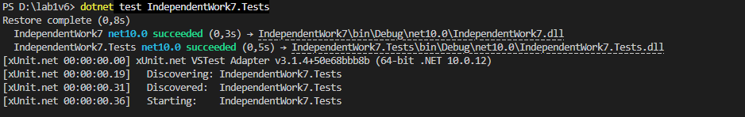
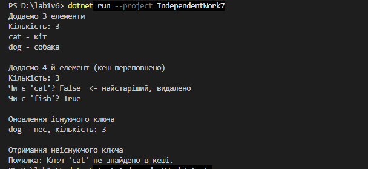

Самостійна робота №7
====================

## ема
Узагальнений кеш `Cache<TKey, TValue>` із тестами.

## Мета
 Розробити узагальнений клас кешу, який зберігає дані за ключем та має політику видалення найстаріших елементів (FIFO — First In, First Out), а також написати юніт-тести для перевірки його функціональності.

## Хід роботи

1. **Створено консольний проєкт:** `dotnet new console -o IndependentWork7`
2. **Створено проєкт для тестів:** `dotnet new xunit -o IndependentWork7.Tests` та додано посилання на основний проєкт.
3. **Реалізовано клас `Cache<TKey, TValue>`:**
   * Приватні поля `_capacity`, `_cache` (`Dictionary<TKey, TValue>`) та `_keysOrder` (`Queue<TKey>`).
   * Конструктор `Cache(int capacity)` з перевіркою ємності.
   * Метод `Add()` — при переповненні видаляє найстаріший ключ через `Dequeue()`, а для існуючого ключа оновлює значення.
   * Метод `Get()` — використовує `TryGetValue` і кидає `KeyNotFoundException`, якщо ключа немає.
   * Метод `ContainsKey()` та властивість `Count`.
4. **Написано 12 юніт-тестів (`IndependentWork7.Tests`):**
   * Перевірено `Add`, `Get`, `ContainsKey`, `Count`, неіснуючий ключ, переповнення кешу та порядок видалення елементів.
5. **Демонстрація в `Main`:**
   * Створено `Cache<string, string>` на 3 елементи, додано 4 слова й показано, що найстаріше видалилося.

## Фотозвіт Тест

## Фотозвіт консольного виводу програми

---

## Контрольні запитання

1. **Які переваги надає `Cache<TKey, TValue>` порівняно з окремими неузагальненими реалізаціями кешу?**
   * Один клас працює з будь-якими типами ключів і значень, тож не треба писати окремий кеш для рядків, чисел чи об'єктів. Компілятор перевіряє типи, тому не потрібне приведення через `object`, а для типів-значень немає упаковки.
2. **Чому для реалізації політики FIFO зручно поєднувати `Dictionary<TKey, TValue>` з `Queue<TKey>`?**
   * `Dictionary` швидко знаходить значення за ключем, але не пам'ятає порядок додавання. `Queue` працює саме за принципом FIFO: `Enqueue()` додає ключ у кінець, а `Dequeue()` дістає найстаріший. Разом вони дають і швидкий пошук, і правильний порядок видалення.
3. **У яких випадках метод `Get` повинен викидати `KeyNotFoundException`, а коли доцільніше використовувати підхід на кшталт `TryGetValue`?**
   * Виняток доречний, коли ключ **обов'язково** має бути в кеші, і його відсутність — справжня помилка. `TryGetValue` краще, коли відсутність ключа — звичайна ситуація (для кешу це часто так): тоді метод просто повертає `false` без винятку, і це працює швидше.
4. **Які тести є критично важливими для перевірки політики витіснення елементів з кешу?**
   * Що при переповненні видаляється саме **найстаріший** елемент, а нові залишаються; що `Count` не перевищує ємність; що при кількох переповненнях елементи видаляються в порядку додавання; що оновлення існуючого ключа не змінює порядок; і що видалений ключ більше не можна отримати.