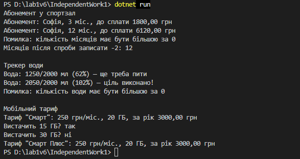

Самостійна робота №1

## Тема
Базовий синтаксис C# і оголошення класів.

## Мета
Закріпити навички оголошення класів, полів, властивостей та методів у C# для моделювання об'єктів реального світу.

## Хід роботи

1. **Створено консольний проєкт:** `dotnet new console -o IndependentWork1`
2. **Оголошено 3 класи:**
   * **`GymMembership` (абонемент у спортзал):** приватні поля `_ownerName`, `_pricePerMonth`, `_months`; властивість тільки для читання `OwnerName` та властивість `Months` з перевіркою; методи `GetTotalPrice()`, `Extend()` та `PrintInfo()`.
   * **`WaterTracker` (трекер води):** приватні поля `_dailyGoal`, `_drunk`; властивість `DailyGoal` з перевіркою та властивість тільки для читання `Drunk`; методи `Drink()`, `GetProgress()`, `IsGoalReached()` та `PrintStatus()`.
   * **`PhoneTariff` (мобільний тариф):** приватні поля `_name`, `_monthlyPrice`, `_internetGb`; властивість `Name` та властивість тільки для читання `MonthlyPrice`; методи `GetYearPrice()`, `HasEnoughInternet()` та `PrintInfo()`.
3. **Додано конструктори:**
   * Кожен клас має конструктор, який приймає параметри для ініціалізації полів.
4. **Демонстрація роботи в `Main`:**
   * Створено по одному об'єкту кожного класу, викликано їхні методи, а результати виведено в консоль.
   * Перевірено, що некоректні значення (від'ємні місяці чи кількість води) не записуються.

## Фотозвіт

## Контрольні запитання

1. **Які мінімальні елементи повинен містити клас у цьому завданні?**
   * Мінімум 2 приватні поля, 1 публічну властивість, 1 метод і конструктор з параметрами.
2. **Чому поля доцільно робити приватними, а доступ до них надавати через властивості?**
   * Так дані захищені від некоректних змін ззовні. У властивості можна додати перевірку (як у `Months` чи `DailyGoal`) або зробити її тільки для читання (як `OwnerName`).
3. **Для чого в класі потрібен конструктор і як він пов'язаний зі станом об'єкта?**
   * Конструктор викликається під час створення об'єкта через `new` і задає початкові значення полів, тому об'єкт одразу має коректний стан.
4. **Як у `Main` показати, що методи класу працюють коректно?**
   * Створити об'єкти з відомими даними, викликати методи та вивести результати в консоль, щоб порівняти їх з очікуваними. Також варто перевірити некоректні значення.
