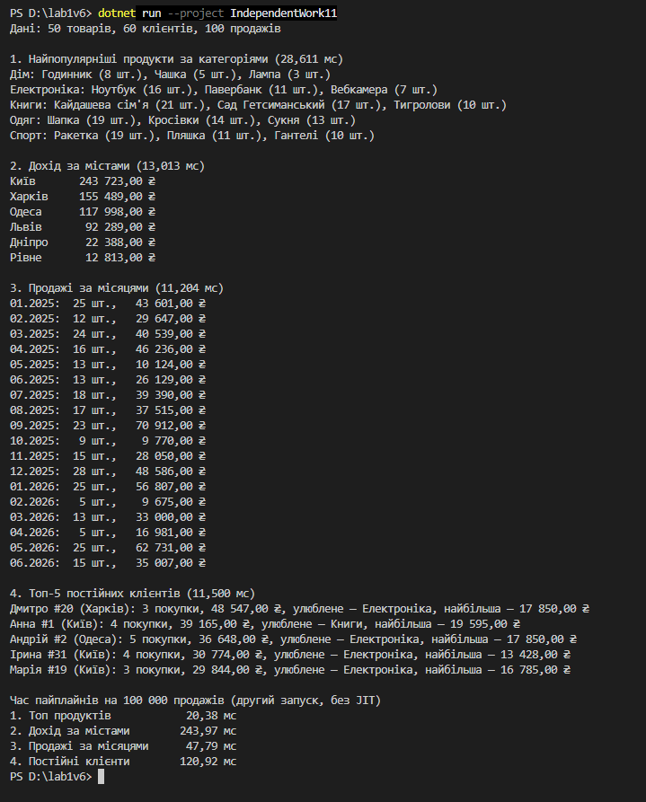

Самостійна робота №11
=====================

## Тема
LINQ pipelines: ETL та аналітика.

## Мета
Розробити та проаналізувати складні LINQ-пайплайни для обробки даних, що імітують сценарії ETL (Extract, Transform, Load) та аналітики, використовуючи різні оператори LINQ.

## Хід роботи

1. **Створено консольний проєкт:** `dotnet new console -o IndependentWork11`
2. **Створено модель «Продажі»:**
   * Класи `Product`, `Customer`, `Sale`; `DataGenerator` генерує 50 товарів, 60 клієнтів і 100 продажів через `Random(42)`.
3. **Реалізовано 4 пайплайни (`Pipelines.cs`):**
   * **`TopProductsByCategory`** — топ-3 продукти в кожній категорії (`GroupBy`, `Join`, `OrderByDescending`, `Take`).
   * **`RevenueByCity`** — дохід за містами (`Join` ×2, `GroupBy`, `Sum`, `OrderByDescending`).
   * **`SalesByMonth`** — одиниці й дохід за місяцями (`GroupBy` за анонімним ключем, `OrderBy`, `ThenBy`).
   * **`TopLoyalCustomers`** (мій) — топ-5 клієнтів з 3+ покупками (`Where` після `GroupBy`, вкладений `GroupBy`, `Aggregate`).
4. **Виміряно час** кожного пайплайна окремим `Stopwatch` на 100 і на 100 000 продажів.

## Фотозвіт

## Контрольні запитання

1. **Які переваги дає LINQ для побудови ETL-пайплайнів порівняно з ручними циклами?**
   * Код коротший і читається як послідовність кроків; не потрібно вручну створювати словники для групування чи проміжні списки; готові оператори (`Join`, `GroupBy`, `Sum`) менш схильні до помилок.
2. **Чому для аналітичних задач часто поєднують `Join`, `GroupBy`, `Select` та `OrderBy` в одному пайплайні?**
   * Дані лежать у різних колекціях: `Join` з'єднує їх, `GroupBy` збирає за потрібною ознакою, `Select` рахує підсумки, а `OrderBy` впорядковує результат. Це типовий шлях від «сирих» записів до звіту.
3. **Які фактори можуть найбільше впливати на продуктивність складних LINQ-запитів?**
   * Обсяг даних, кількість `Join`/`GroupBy`/сортувань, порядок операцій (фільтрувати краще раніше), повторне виконання запиту через відкладене виконання, JIT і збирач сміття.
4. **Як перевірити, що LINQ-пайплайн не лише працює, а й залишається читабельним і підтримуваним?**
   * Кожен пайплайн винесено в окремий метод з промовистою назвою; кожен крок на окремому рядку з коментарем; результат має свій тип (`record`) замість безіменних полів; правильність можна перевірити на малих даних, де результат легко порахувати вручну.
