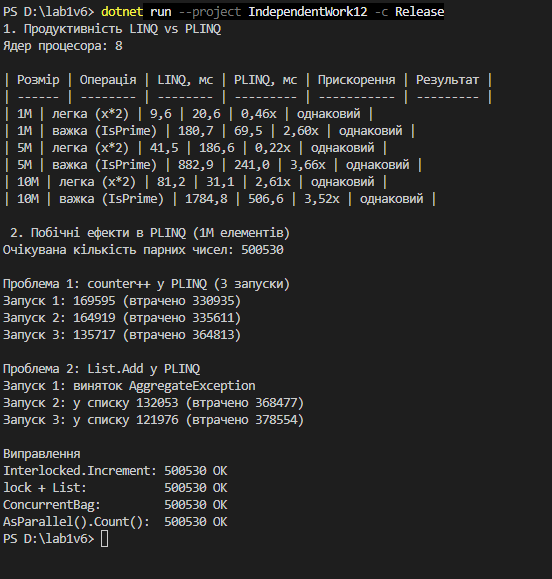

Самостійна робота №12
=====================

## Тема
PLINQ: дослідження продуктивності та безпеки.

## Мета
Дослідити переваги та недоліки PLINQ (Parallel LINQ) у порівнянні зі звичайним LINQ, виміряти його продуктивність на різних обсягах даних та проаналізувати потенційні проблеми безпеки при паралельній обробці.

## Хід роботи

1. **Створено консольний проєкт:** `dotnet new console -o IndependentWork12`
2. **Створено великі колекції:** `List<int>` на 1M, 5M і 10M випадкових чисел (`Random(42)`).
3. **Порівняно LINQ і PLINQ (`PerformanceTests.cs`):**
   * Легка операція `Where(x % 2 == 0).Select(x * 2).Sum()` і важка `Where(IsPrime).Sum()`.
   * Час виміряно `Stopwatch` після розігріву, результати двох підходів перевірено на рівність.
4. **Досліджено побічні ефекти (`SafetyDemo.cs`):**
   * Показано втрату даних при `counter++` і `List.Add` всередині `ForAll`.
   * Виправлено через `Interlocked`, `lock`, `ConcurrentBag` і запит без побічних ефектів.

## Фотозвіт

## Контрольні запитання

1. **За яких умов PLINQ зазвичай дає виграш у продуктивності порівняно зі звичайним LINQ?**
   * Коли колекція велика, операція над кожним елементом обчислювально важка й елементи обробляються незалежно один від одного, а в процесорі кілька ядер.
2. **Чому побічні ефекти всередині PLINQ-запитів можуть призводити до некоректних результатів?**
   * Кілька потоків одночасно змінюють ту саму змінну чи колекцію. Операції на кшталт `counter++` не атомарні, тому зміни одного потоку перезаписують зміни іншого, і дані губляться.
3. **Для чого в експериментах важливо порівнювати кілька розмірів колекції, а не один випадок?**
   * Щоб побачити, з якого обсягу паралельність починає окуплятися. На малих даних накладні витрати на потоки можуть бути більшими за виграш, а на великих — навпаки.
4. **Які висновки слід зробити, якщо PLINQ виявився повільнішим за LINQ у частині тестів?**
   * Що операція надто легка або даних замало, і накладні витрати перевищують користь. У таких випадках варто залишити звичайний LINQ, а PLINQ використовувати лише там, де вимірювання показують реальне прискорення.
