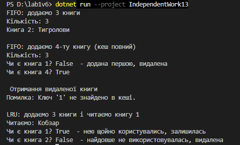
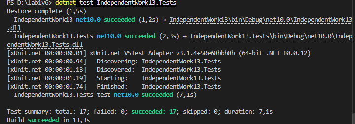

Самостійна робота №13
=====================

## Тема
Узагальнений кеш `Cache<TKey, TValue>` із тестами.

## Мета
Розробити узагальнений клас кешу, який зберігає дані за ключем та має політику видалення найстаріших елементів (FIFO — First In, First Out), а також написати юніт-тести для перевірки його функціональності. Додатково реалізувати LRU як розширення базового рішення.

## Хід роботи

1. **Створено консольний проєкт:** `dotnet new console -o IndependentWork13`
2. **Створено проєкт для тестів:** `dotnet new xunit -o IndependentWork13.Tests` і додано посилання на основний проєкт.
3. **Реалізовано клас `Cache<TKey, TValue>` (FIFO):**
   * Приватні поля `_capacity`, `_cache` (`Dictionary<TKey, TValue>`) і `_keysOrder` (`Queue<TKey>`).
   * Конструктор `Cache(int capacity)` перевіряє, що ємність більша за 0.
   * `Add()` — якщо кеш повний, видаляє найстаріший ключ через `Dequeue()`; існуючий ключ просто оновлює.
   * `Get()` — шукає через `TryGetValue`, а якщо ключа немає, кидає `KeyNotFoundException`.
   * `ContainsKey()` і властивість `Count`.
4. **Розширення — клас `LruCache<TKey, TValue>`:**
   * Порядок ключів зберігається в `LinkedList<TKey>`; при `Get` і оновленні ключ переноситься в кінець.
   * При переповненні видаляється перший ключ, тобто той, яким найдовше не користувались.
5. **Написано 17 юніт-тестів:**
   * **`CacheTests` (13):** `Add`, `Get`, `ContainsKey`, `Count`, неіснуючий ключ, переповнення, порядок видалення, оновлення ключа.
   * **`LruCacheTests` (4):** видалення найдавніше використаного елемента та різниця з FIFO.
6. **Демонстрація в `Main`:** `Cache<int, Book>` на 3 книги — після додавання 4-ї видаляється перша; у `LruCache` книга, яку щойно читали, залишається.

## Фотозвіти

![Результат dotnet test]

![Консольний вивід програми]

## Контрольні запитання

1. **Які переваги надає `Cache<TKey, TValue>` порівняно з окремими неузагальненими реалізаціями кешу?**
   * Один клас працює з будь-якими типами: у мене це `Cache<int, Book>`, а в тестах `Cache<string, int>`. Не треба писати окремий кеш під кожен тип, компілятор сам перевіряє типи, і не потрібне приведення через `object`.
2. **Чому для реалізації політики FIFO зручно поєднувати `Dictionary<TKey, TValue>` з `Queue<TKey>` або `LinkedList<TKey>`?**
   * `Dictionary` швидко знаходить значення за ключем, але не пам'ятає, в якому порядку ключі додавали. `Queue` якраз пам'ятає порядок: `Dequeue()` одразу дає найстаріший ключ. `LinkedList` потрібен для LRU, бо з нього можна прибрати ключ із середини і перенести в кінець.
3. **У яких випадках метод `Get` повинен викидати `KeyNotFoundException`, а коли доцільніше використовувати підхід на кшталт `TryGetValue`?**
   * Виняток — коли ключ обов'язково мав бути, і його відсутність є помилкою. `TryGetValue` — коли відсутність ключа нормальна ситуація, як часто буває з кешем: метод просто повертає `false`, без винятку, і працює швидше.
4. **Які тести є критично важливими для перевірки політики витіснення елементів з кешу?**
   * Що при переповненні видаляється саме найстаріший елемент, а нові лишаються; що `Count` не більший за ємність; що при кількох переповненнях елементи видаляються в порядку додавання; що оновлення ключа не ламає порядок; що видалений ключ більше не можна отримати.
