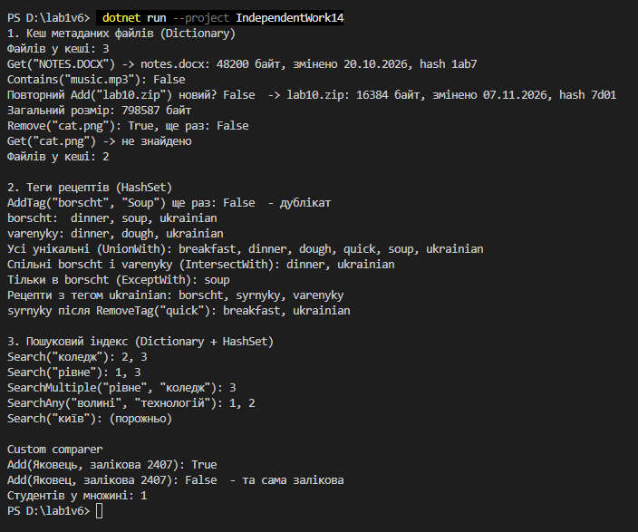

Самостійна робота №14
=====================

## Тема
Вивчення `Dictionary<TKey, TValue>` та `HashSet<T>` у бібліотеках .NET.

## Мета
Дослідити реальні приклади використання узагальнених колекцій у популярних .NET-бібліотеках та зрозуміти, як вони застосовуються для вирішення практичних задач.

## Хід роботи

1. **Проаналізовано open-source проєкти:** знайдено приклади `Dictionary` у FluentValidation, `HashSet` в AutoMapper та обох колекцій разом у MediatR. Аналіз — у [`REPORT.md`](REPORT.md).
2. **Створено консольний проєкт:** `dotnet new console -o IndependentWork14`
3. **Реалізовано сценарії:**
   * **`FileMetadataCache` (сценарій 1):** `Dictionary<string, FileMetadata>` з `StringComparer.OrdinalIgnoreCase`; методи `Add`, `Get`, `Remove`, `Contains` і `TotalSize`.
   * **`TagManager` (сценарій 2):** `Dictionary<string, HashSet<string>>`; `UnionWith` — усі теги, `IntersectWith` — спільні, `ExceptWith` — різниця, а також пошук рецептів за тегом.
   * **`SearchIndex` (сценарій 3, додатково):** інвертований індекс `Dictionary<string, HashSet<int>>`; `SearchMultiple` — перетин, `SearchAny` — об'єднання.
   * **`RecordBookComparer`:** власний `IEqualityComparer<Student>`, який порівнює студентів за номером залікової.
4. **Складено порівняльну таблицю й висновки** у `REPORT.md`.

## Фотозвіт
![Консольний вивід програми]

## Контрольні запитання

1. **Які переваги generic-колекцій над неузагальненими структурами даних у .NET?**
   * Тип перевіряється ще під час компіляції: в `Dictionary<string, FileMetadata>` не покладеш випадково число. Не треба приводити `object` до потрібного типу, і для `int` немає упаковки (boxing), тому вони швидші за старі `Hashtable` чи `ArrayList`.
2. **У яких сценаріях доцільніше використовувати `Dictionary<TKey, TValue>`, а в яких — `HashSet<T>`?**
   * `Dictionary` — коли за ключем треба отримати дані (ім'я файлу → метадані). `HashSet` — коли важливо лише, чи є елемент, і щоб не було повторів (теги), або потрібні операції над множинами: об'єднання, перетин, різниця.
3. **Як `IEqualityComparer<T>` впливає на коректність і продуктивність `Dictionary` та `HashSet`?**
   * Він вирішує, які елементи вважати однаковими. Без нього `"Soup"` і `"soup"` були б різними тегами, а два об'єкти `Student` порівнювались би за посиланням. Якщо `GetHashCode` поганий (наприклад, для всіх повертає те саме число), усі елементи потрапляють в одне місце, і пошук сповільнюється з O(1) до O(n).
4. **Чому інвертований індекс зручно будувати саме на базі `Dictionary<string, HashSet<int>>`?**
   * `Dictionary` за O(1) знаходить слово, а `HashSet<int>` зберігає номери документів без повторів, навіть якщо слово трапилось у документі кілька разів. До того ж пошук за кількома словами — це просто `IntersectWith` (усі слова) або `UnionWith` (хоча б одне).
