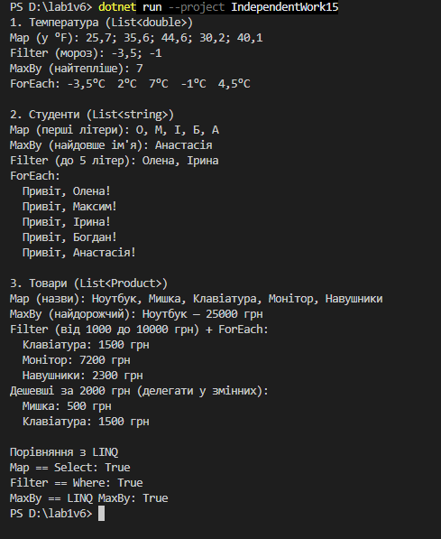

Самостійна робота №15
=====================

## Тема
Делегати й лямбда-вирази: власні утиліти для колекцій.

## Мета
Поглибити розуміння делегатів та лямбда-виразів через створення власних узагальнених методів-утиліт для роботи з колекціями та повторного використання логіки.

## Хід роботи

1. **Створено консольний проєкт:** `dotnet new console -o IndependentWork15`
2. **Реалізовано статичний клас `CollectionUtils`:**
   * **`Map<TSource, TResult>`** — перетворює кожен елемент через `Func`; працює через `yield return`, як `Select`.
   * **`MaxBy<T, TKey>`** — елемент з найбільшим ключем; обмеження `where TKey : IComparable<TKey>`, для порожньої колекції кидає виняток.
   * **`Filter<T>`** — елементи, для яких `Predicate` повертає `true`; теж через `yield return`.
   * **`ForEach<T>`** — виконує `Action` для кожного елемента.
3. **Продемонстровано на трьох колекціях:**
   * **`List<double>`** — температура: переведення в °F, морози, найтепліший день.
   * **`List<string>`** — імена студентів: перші літери, найдовше ім'я, короткі імена.
   * **`List<Product>`** — товари: назви, найдорожчий, товари в діапазоні цін; делегати збережено у змінних `isCheap` і `print`.
4. **Порівняно результати з LINQ** (`Select`, `Where`, `MaxBy`) через `SequenceEqual`.

## Фотозвіт
![Консольний вивід програми]

## Звіт

1. **Чому делегати корисні для таких утиліт?**
   * Метод пише цикл один раз, а що робити з елементом, передається ззовні. Тому один `Filter` працює і для температур, і для товарів.
2. **Як лямбда-вирази спрощують виклик?**
   * Умову пишу прямо у виклику (`p => p.Price < 2000`), без окремого методу.
3. **Порівняння з LINQ.**
   * `Map` = `Select`, `Filter` = `Where`, `MaxBy` = LINQ `MaxBy`; результати однакові (`True`). Мої `Map` і `Filter` теж відкладені (`yield return`). `ForEach` у LINQ немає. LINQ зручніший: методи розширення, ланцюжки, оптимізації.

## Контрольні запитання

1. **Чому делегати є зручним механізмом для передавання поведінки в узагальнені методи?**
   * Делегат — це «змінна з методом». Метод не знає, яку саме дію виконає, тому один код підходить для різних задач.
2. **У чому різниця між `Func<T, TResult>`, `Action<T>` та `Predicate<T>`?**
   * `Func` повертає результат, `Action` нічого не повертає, `Predicate` повертає `bool` (умова).
3. **Які переваги дає поєднання generic-методів і лямбда-виразів під час роботи з колекціями?**
   * Generic — працює з будь-яким типом, лямбда — коротко задає дію. Разом: один метод на всі колекції і мало коду.
4. **У яких випадках власні утиліти на кшталт `Map` чи `Filter` корисно реалізувати самостійно, навіть якщо існує LINQ?**
   * Для навчання, щоб зрозуміти, як працює LINQ, або коли потрібна своя логіка, якої в LINQ немає (як `ForEach`).
