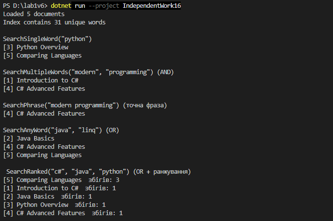
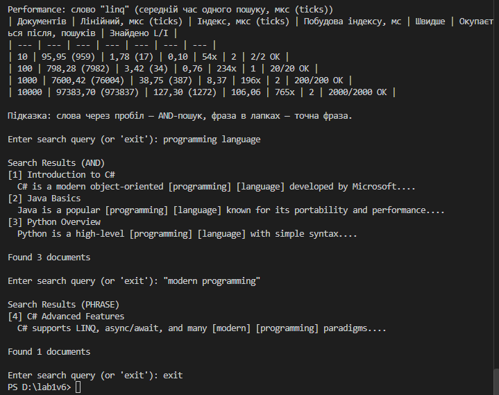

Самостійна робота №16
=====================

## Тема
Колекції в практиці ООП: інвертований індекс і вимірювання продуктивності.

## Мета
Розробити власну реалізацію інвертованого індексу для повнотекстового пошуку та порівняти продуктивність різних підходів до пошуку в колекціях.

## Хід роботи

1. **Створено консольний проєкт:** `dotnet new console -o IndependentWork16`
2. **Реалізовано класи:**
   * **`Document`** — документ (`Id`, `Title`, `Content`).
   * **`TextProcessor`** — `Tokenize` (Regex `[\w#+]+`, нижній регістр), `RemoveStopWords`, `Normalize` і `Highlight` (підсвітка слів у `[ ]`).
   * **`InvertedIndex`** — `Dictionary<string, HashSet<int>>` (слово → документи) і `Dictionary<int, Document>`; методи `SearchSingleWord`, `SearchMultipleWords` (AND, `IntersectWith`), `SearchAnyWord` (OR, `UnionWith`).
3. **Завдання з зірочкою:**
   * **`SearchPhrase`** — точна фраза: спочатку AND, потім перевірка, що слова йдуть поспіль.
   * **`SearchRanked`** — OR-пошук, відсортований за кількістю збігів.
   * **Підсвітка** знайдених слів в інтерактивному пошуку.
4. **Виміряно продуктивність** (`PerformanceTest`): лінійний пошук і індекс з однаковою нормалізацією для 10, 100, 1000, 10000 документів; окремо заміряно час побудови індексу.
5. **Інтерактивний пошук:** слова через пробіл — AND, фраза в лапках — точна фраза.

## Фотозвіт
![Консольний вивід програми]

Таблиця вимірювань і висновки — у [`REPORT.md`](REPORT.md).

## Контрольні запитання

1. **Чому структура `Dictionary<string, HashSet<int>>` добре підходить для реалізації інвертованого індексу?**
   * `Dictionary` знаходить слово за O(1), а `HashSet` зберігає документи без повторів.
2. **Які переваги `HashSet<T>` дає під час обчислення AND/OR-пошуку за кількома словами?**
   * Готові операції: AND — `IntersectWith`, OR — `UnionWith`, без власних циклів і дублікатів.
3. **Чому під час вимірювання продуктивності важливо однаково нормалізувати текст для лінійного пошуку та пошуку через індекс?**
   * Інакше методи знаходять різну кількість документів і порівнюємо різну роботу.
4. **Які обмеження має проста реалізація інвертованого індексу без ранжування, стемінгу та підтримки фраз?**
   * «language» і «languages» — різні слова, порядок слів не враховується, результати не впорядковані за важливістю.
