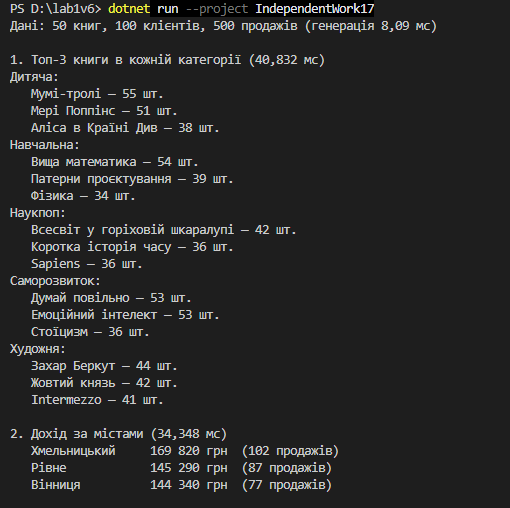
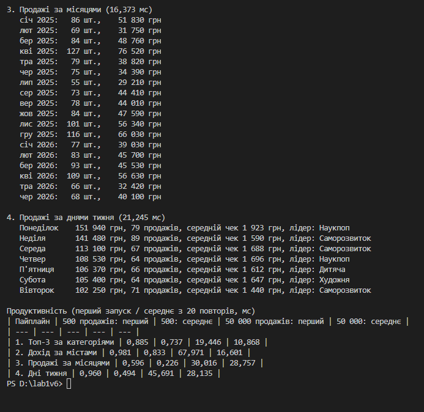

Самостійна робота №17
=====================

## Тема
LINQ pipelines: ETL та аналітика.

## Мета
Розробити та проаналізувати складні LINQ-пайплайни для обробки даних, що імітують сценарії ETL (Extract, Transform, Load) та аналітики, використовуючи різні оператори LINQ.

## Хід роботи

1. **Створено консольний проєкт:** `dotnet new console -o IndependentWork17`
2. **Створено сутності сценарію «Продажі» (книгарня):** `Sale`, `Product`, `Customer` і `record`-и для результатів.
3. **Extract — `DataGenerator`:** 50 книг (5 категорій), 100 клієнтів (6 міст), 500 продажів за 18 місяців; `Random` з фіксованим seed.
4. **Transform — `Pipelines`** (синтаксис запитів):
   * **Пайплайн 1:** `group by` продукт → `Sum` → `join` з книгами → `group by` категорія → топ-3 (`orderby` + `Take`).
   * **Пайплайн 2:** два `join` (книги й клієнти) → дохід `Quantity * UnitPrice` → `group by` місто → `let` + `Sum` → `orderby descending`.
   * **Пайплайн 3:** `join` → `group by new { Year, Month }` → `Sum` кількості й доходу → `orderby` рік, місяць.
   * **Пайплайн 4 (мій):** дні тижня — дохід, кількість продажів, середній чек і найприбутковіша категорія (`join`, `let`, `group by`, вкладений `group by`, `orderby`, `First`).
5. **Load:** результати виводяться в консоль; кожен пайплайн має свій `Stopwatch`.
6. **Продуктивність:** перший запуск і середнє з 20 повторів на 500 і 50 000 продажів.

## Фотозвіт
![Консольний вивід програми]

Опис пайплайнів, таблиця часу й висновки — у [`REPORT.md`](REPORT.md).

## Контрольні запитання

1. **Які переваги дає LINQ для побудови ETL-пайплайнів порівняно з ручними циклами?**
   * Код коротший і читається як послідовність кроків; не треба вручну заводити словники для групування.
2. **Чому для аналітичних задач часто поєднують `Join`, `GroupBy`, `Select` та `OrderBy` в одному пайплайні?**
   * Дані лежать у різних колекціях: `Join` їх з'єднує, `GroupBy` групує, `Select` рахує підсумки, `OrderBy` впорядковує результат.
3. **Які фактори можуть найбільше впливати на продуктивність складних LINQ-запитів?**
   * Обсяг даних, кількість `join` і групувань, сортування, створення проміжних об'єктів, JIT при першому запуску.
4. **Як перевірити, що LINQ-пайплайн не лише працює, а й залишається читабельним і підтримуваним?**
   * Кожен пайплайн — окремий метод із промовистою назвою, проміжні кроки названі (`let`, змінні), результати перевіряються на відомих даних.
