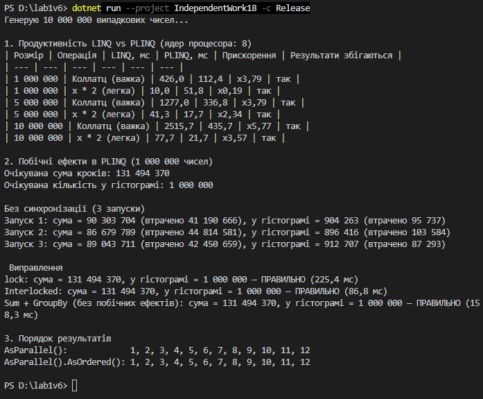

Самостійна робота №18
=====================
## Тема
PLINQ: дослідження продуктивності та безпеки.

## Мета
Дослідити переваги та недоліки PLINQ (Parallel LINQ) у порівнянні зі звичайним LINQ, виміряти його продуктивність на різних обсягах даних та проаналізувати потенційні проблеми безпеки при паралельній обробці.

## Хід роботи

1. **Створено консольний проєкт:** `dotnet new console -o IndependentWork18`
2. **Згенеровано дані:** `List<int>` на 10 млн випадкових чисел від 1 до 1 000 000 (`Random` з seed 18).
3. **Обрано операції:**
   * **важка** — кількість кроків гіпотези Коллатца (у середньому ~130 ітерацій циклу на число);
   * **легка** — `x * 2`, для порівняння.
4. **Порівняно LINQ і PLINQ** (`.Where(...).Select(...).Sum()` і `.AsParallel()...`) на 1M, 5M і 10M елементів; час виміряно `Stopwatch`, перевірено, що результати збігаються.
5. **Продемонстровано побічні ефекти:** спільні `long total` і масив-гістограма змінюються в `ForAll` без синхронізації, тому частина оновлень губиться.
6. **Виправлено трьома способами:** `lock`, `Interlocked`, PLINQ без спільних змінних (`Sum`, `GroupBy`).
7. **Показано порядок результатів:** `AsParallel()` і `AsParallel().AsOrdered()`.

## Фотозвіт

## Контрольні запитання

1. **За яких умов PLINQ зазвичай дає виграш у продуктивності порівняно зі звичайним LINQ?**
   * Коли даних багато, операція над кожним елементом важка, елементи незалежні, а в процесора кілька ядер.
2. **Чому побічні ефекти всередині PLINQ-запитів можуть призводити до некоректних результатів?**
   * Кілька потоків одночасно змінюють одну змінну: `total += x` — це «прочитати, додати, записати», і записи перезаписують один одного.
3. **Для чого в експериментах важливо порівнювати кілька розмірів колекції, а не один випадок?**
   * Щоб побачити, як змінюється виграш: на малих даних витрати на потоки можуть з'їсти користь, а на великих — ні.
4. **Які висновки слід зробити, якщо PLINQ виявився повільнішим за LINQ у частині тестів?**
   * Що операція занадто легка або даних мало, і розподіл між потоками коштує більше, ніж сама робота. Тоді PLINQ не потрібен.
