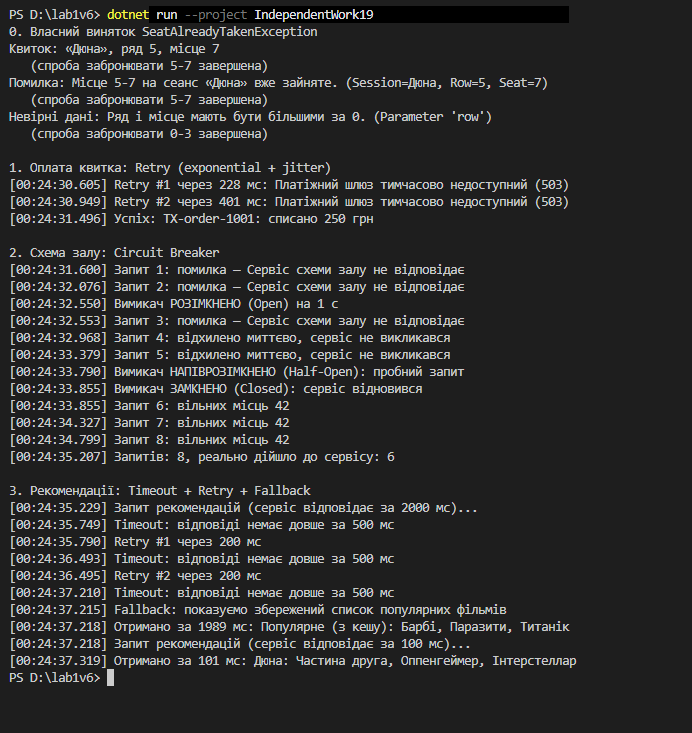

Самостійна робота №19
=====================
## Тема
Дизайн винятків і політики retry: теорія та кейси Polly.

## Мета
Опрацювати теорію обробки винятків у .NET, вивчити патерни відмовостійкості (Retry, Circuit Breaker, Bulkhead) та бібліотеку Polly, реалізувати практичні сценарії й підготувати звіт.

## Хід роботи
2. **Створено власний виняток `SeatAlreadyTakenException`** (предметна область — кінотеатр):
   * властивості `Session`, `Row`, `Seat`;
   * три стандартні конструктори та конструктор з контекстом;
   * демонстрація в `Main`: `try` → `catch` від специфічного до загального → `finally`.
3. **Реалізовано 3 сценарії Polly через `ResiliencePipelineBuilder`:**
   * **Оплата квитка — Retry** з експоненційною затримкою та jitter (шлюз двічі повертає 503).
   * **Схема залу — Circuit Breaker:** після 3 помилок запити миттєво відхиляються, через 1 с пробний запит і відновлення.
   * **Рекомендації — Timeout + Retry + Fallback:** сервіс «висить» 2 с, кожна спроба обривається через 0,5 с, після 3 спроб показується список з кешу.
4. **Логування:** кожна спроба й зміна стану з часом (`OnRetry`, `OnOpened`, `OnHalfOpened`, `OnClosed`, `OnTimeout`, `OnFallback`).
5. **Звіт** — у [`REPORT.md`](REPORT.md).

## Результат
![Консольний вивід програми]

## Контрольні запитання

1. **Поясніть різницю між підходами «кидати виняток» та «повертати Result». Наведіть приклад для кожного.**
   * Виняток — коли метод не може виконати свою роботу: `BookSeat` для вже зайнятого місця кидає `SeatAlreadyTakenException`. `Result` — коли невдача очікувана: перевірка, чи вільне місце, повертає `Result.Failure`, а не виняток.
2. **Які три стандартні конструктори рекомендується реалізовувати у власному типі винятку?**
   * Без параметрів, з `message` і з `message` + `innerException`.
3. **Чим Circuit Breaker відрізняється від Retry? Коли який патерн доцільніший?**
   * Retry повторює запит і доцільний для коротких збоїв. Circuit Breaker, навпаки, перестає звертатися до сервісу, який «ліг» надовго, щоб не навантажувати його марними запитами.
4. **Для чого потрібен Bulkhead і яку проблему він вирішує?**
   * Обмежує кількість одночасних викликів до одного сервісу, щоб його збій не забрав усі потоки й з'єднання в решти програми.
5. **Чому Jitter важливий при реалізації Retry з експоненційною затримкою?**
   * Без нього тисячі клієнтів повторюють запит в одну й ту саму мить і знову «кладуть» сервер. Jitter розносить повтори в часі.
6. **Які ризики виникають при застосуванні Retry до неідемпотентної операції?**
   * Дія може виконатися двічі, наприклад гроші спишуться двічі. Тому в оплату передається ключ ідемпотентності (`order-1001`).

