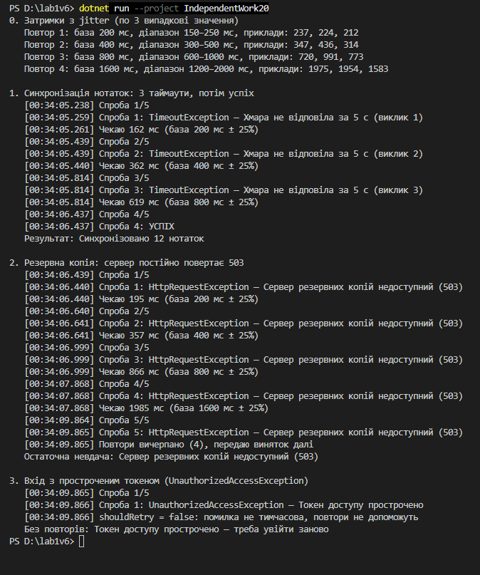

Самостійна робота №20
=====================

## Тема
Реалізація exponential backoff.

## Мета
Розробити власний допоміжний клас для реалізації патерну Retry з експоненційною затримкою та випадковим «jitter».

## Хід роботи

1. **Створено консольний проєкт:** `dotnet new console -o IndependentWork20`
2. **Реалізовано клас `RetryPolicy`:**
   * приватні поля `_maxRetries`, `_initialDelay`, `_jitterFactor` і `Random`;
   * конструктор `RetryPolicy(int maxRetries, TimeSpan initialDelay, double jitterFactor = 0.2)` з перевіркою параметрів;
   * **`GetDelay(retryAttempt)`** — формула з методички: `initialDelay * 2^retryAttempt * (1 + random * jitter * 2 - jitter)`;
   * **`Execute<T>(Func<T>, Func<Exception, bool>? shouldRetry)`** — узагальнений метод, придатний для будь-якої операції; логує номер спроби, причину невдачі й затримку; після вичерпання повторів або при `shouldRetry = false` кидає виняток далі.
3. **Мої параметри:** `maxRetries = 4`, `initialDelay = 200 мс`, `jitterFactor = 0.25` (±25%).
4. **Сценарії в `Main`** (`shouldRetry` повторює лише `TimeoutException` і `HttpRequestException`):
   * **розкид затримок:** приклади випадкових значень для кожного повтору;
   * **синхронізація нотаток:** 3 таймаути → успіх на 4-й спробі;
   * **резервна копія:** сервер завжди повертає 503 → 5 спроб → виняток;
   * **прострочений токен:** `UnauthorizedAccessException` → одразу виняток, без повторів.

## Фотозвіт
![Консольний вивід програми]! 

### Висновок: межі застосування Retry з exponential backoff

Retry з експоненційною затримкою доречний лише для **тимчасових** збоїв: таймаут, 503, перевантажений сервер. Тоді пауза, що подвоюється, дає сервісу час відновитися, а jitter не дає всім клієнтам повторити запит одночасно. Для **постійних** помилок (неправильний токен, невалідні дані, 404) повтори марні, тому їх відсікає `shouldRetry`. Небезпечно повторювати **неідемпотентні** операції (оплата, створення замовлення) без ключа ідемпотентності, бо дія може виконатися двічі. Загальний час очікування росте дуже швидко (у мене 4 повтори — це вже ~3 с), тому кількість спроб треба обмежувати, а при тривалій відмові сервісу краще застосовувати Circuit Breaker.

## Контрольні запитання

1. **Чому експоненційна затримка зазвичай ефективніша за фіксовану для тимчасових збоїв?**
   * Перші повтори швидкі (короткий збій минає одразу), а далі пауза росте, і перевантажений сервер не засипають запитами.
2. **Для чого потрібен jitter і як він зменшує ризик одночасних повторних спроб?**
   * Він додає випадкові ±25% до затримки, тож клієнти, які впали одночасно, повторюють запит у різні моменти, а не всі разом.
3. **Яку роль відіграє делегат `shouldRetry` у власній реалізації політики повторних спроб?**
   * Він вирішує, які винятки варто повторювати. Тимчасові (`TimeoutException`) — так, постійні (`UnauthorizedAccessException`) — ні.
4. **У яких випадках повторна спроба не є безпечною та її слід заборонити?**
   * Для неідемпотентних дій без захисту від дублювання (оплата, відправка листа) і для постійних помилок, де повтор нічого не змінить.

