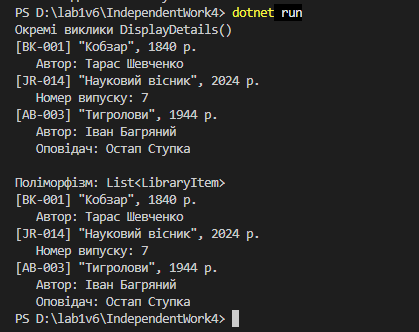

Самостійна робота №4
====================

## Тема
Розширення ієрархії та наслідки змін базового класу.

## Мета
Проаналізувати, як зміни в базовому класі впливають на похідні класи, та дослідити стратегії розширення існуючих ієрархій наслідування.

## Хід роботи

1. **Створено консольний проєкт:** `dotnet new console -o IndependentWork4`
2. **Реалізовано початкову ієрархію:**
   * **`LibraryItem` (базовий клас):** поля `_title`, `_publicationYear`, властивості `Title`, `PublicationYear`, конструктор і віртуальний метод `DisplayDetails()`.
   * **`Book` (похідний клас):** поле `_author`, властивість `Author`, конструктор з викликом `base(...)` та `override DisplayDetails()`.
   * **`Journal` (похідний клас):** поле `_issueNumber`, властивість `IssueNumber`, конструктор з викликом `base(...)` та `override DisplayDetails()`.
3. **Модифіковано базовий клас `LibraryItem`:**
   * Додано приватне поле `_uniqueId`, властивість тільки для читання `UniqueId`, а конструктор тепер приймає `string uniqueId`.
   * Через це оновлено конструктори `Book` і `Journal`.
4. **Розширено ієрархію класом `AudioBook`:**
   * Наслідується від `Book`, має поле `_narrator`, властивість `Narrator`, конструктор з викликом `base(...)` та `override DisplayDetails()`.
5. **Демонстрація роботи в `Main`:**
   * Створено об'єкти `Book`, `Journal`, `AudioBook` і викликано `DisplayDetails()` окремо та через `List<LibraryItem>`.

## Ієрархія
```
LibraryItem
├── Book
│   └── AudioBook
└── Journal
```
## Фотозвіт

## Звіт про наслідки зміни базового класу

### Які зміни були внесені в похідні класи
Після додавання `_uniqueId` конструктор `LibraryItem` став приймати три параметри замість двох. Проєкт одразу перестав компілюватися: у `Book` і `Journal` з'явилася помилка, бо виклик `base(title, publicationYear)` більше не відповідав жодному конструктору базового класу.

У кожному похідному класі довелося:

1. додати параметр `string uniqueId` у конструктор;
2. передати його в базовий конструктор.

**До зміни:**

```csharp
public Book(string title, int publicationYear, string author)
    : base(title, publicationYear)
```

**Після зміни:**

```csharp
public Book(string uniqueId, string title, int publicationYear, string author)
    : base(uniqueId, title, publicationYear)
```

Так само змінився конструктор `Journal`, а також усі місця в `Main`, де створювались об'єкти. Методи `DisplayDetails()` у нащадках змінювати не довелося: вони викликають `base.DisplayDetails()`, тому `UniqueId` з'явився у виводі автоматично.

### Чому ці зміни були необхідні

Похідний клас **зобов'язаний** викликати один із конструкторів базового класу. У `LibraryItem` залишився лише один конструктор, і він вимагає `uniqueId`, тому кожен нащадок має отримати це значення й передати його далі. Навіть не використовуючи нове поле, `Book` і `Journal` залежать від того, як створюється базовий клас.

### Переваги та недоліки наслідування

* **Переваги:**
  * спільний код (`Title`, `PublicationYear`, `UniqueId`, базовий вивід) написаний один раз;
  * нові типи легко додавати: для `AudioBook` вистачило успадкуватися від `Book`, і вже готовими були і назва, і автор;
  * поліморфізм: `List<LibraryItem>` зберігає книги, журнали й аудіокниги разом, а `DisplayDetails()` виводить кожен по-своєму.
* **Недоліки:**
  * сильна залежність: зміна конструктора базового класу «зламала» всі похідні класи, і чим більше нащадків, тим більше правок;
  * зміни поширюються вниз по всій ієрархії (через `Book` вони зачепили б і `AudioBook`);
  * клас може мати лише один базовий клас.

**Коли наслідування доцільне:** коли є чіткий зв'язок «є-різновидом» (книга *є* бібліотечним елементом, аудіокнига *є* книгою), а базовий клас рідко змінюється.

**Коли може призвести до проблем:** коли базовий клас часто змінюється, ієрархія стає глибокою або потрібно поєднувати різні можливості. Тоді краще підходить композиція.

---

## Контрольні запитання

1. **Як зміна конструктора базового класу вплинула на похідні класи?**
   * `Book` і `Journal` перестали компілюватися, бо їхній виклик `base(...)` більше не відповідав конструктору `LibraryItem`. Довелося додати параметр `uniqueId` у їхні конструктори й передати його в `base(...)`.
2. **Чим відрізняється розширення ієрархії через новий похідний клас від модифікації наявного базового класу?**
   * Новий клас (`AudioBook`) нічого не ламає в існуючому коді: ми лише додаємо нове. Зміна базового класу зачіпає всіх нащадків, і їх доводиться правити. Це відповідає принципу відкритості/закритості: клас має бути відкритим для розширення, але закритим для змін.
3. **У яких випадках для цієї задачі композиція могла б бути кращою за наслідування?**
   * Якщо елемент може поєднувати різні можливості: наприклад, книга одночасно паперова й електронна, або в журналу теж є аудіоверсія. Тоді краще, щоб клас **мав** окремий компонент (наприклад, `AudioInfo` з оповідачем), ніж створювати `AudioJournal`, `AudioBook` тощо.
4. **Як поліморфний виклик `DisplayDetails()` допомагає перевірити правильність ієрархії?**
   * У циклі по `List<LibraryItem>` викликається версія методу фактичного типу. Якщо кожен об'єкт виводить свої дані (автора, номер випуску, оповідача), значить `virtual`/`override` і ланцюжок `base.DisplayDetails()` працюють правильно.
