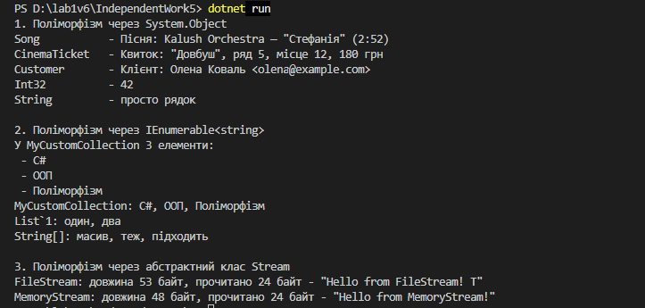

Самостійна робота №5
====================


## Тема
Приклади поліморфізму в .NET.

## Мета
Дослідити, як поліморфізм реалізований та використовується в стандартних бібліотеках .NET, а також проаналізувати його переваги на конкретних прикладах.

## Хід роботи

1. **Створено консольний проєкт:** `dotnet new console -o IndependentWork5`
2. **Поліморфізм через `System.Object`:**
   * Створено класи `Song`, `CinemaTicket`, `Customer`, у кожному з яких перевизначено `ToString()`.
   * Об'єкти цих класів (а також `int` і `string`) додано в `List<object>` і виведено в консоль у циклі `foreach`.
3. **Поліморфізм через `IEnumerable<string>`:**
   * Створено клас `MyCustomCollection` з внутрішнім `List<string>`, який реалізує `IEnumerable<string>` і метод `GetEnumerator()`.
   * Елементи колекції перебрано через `foreach`, а метод `PrintAll(IEnumerable<string>)` викликано для `MyCustomCollection`, `List<string>` і масиву.
4. **Поліморфізм через абстрактний клас `Stream`:**
   * Тестовий файл `test.txt` створено в коді через `File.WriteAllText`.
   * Метод `ProcessStream(Stream stream)` читає перші байти й викликається для `FileStream` та `MemoryStream`.
5. **Підготовлено звіт** (нижче) з висновками для кожного сценарію.


## Фотозвіт


## Звіт

### 1. Поліморфізм через `System.Object`

Усі класи в C# неявно наслідуються від `System.Object`, тому об'єкт будь-якого типу можна зберегти в `List<object>`. У `Object` метод `ToString()` віртуальний, і я перевизначила його у своїх класах:

```csharp
public override string ToString()
{
    return $"Квиток: \"{Movie}\", ряд {Row}, місце {Seat}, {Price} грн";
}
```

Коли в циклі виводимо елементи, тип посилання завжди `object`, але завдяки динамічному зв'язуванню викликається `ToString()` **фактичного** класу:

```csharp
foreach (object item in items)
{
    Console.WriteLine($"{item.GetType().Name,-14} -> {item}");
}
```

Для `Song`, `CinemaTicket` і `Customer` спрацювали мої версії методу, а для `int` і `string` — їхні стандартні реалізації. Якби я не перевизначила `ToString()`, виводилася б просто назва класу (наприклад, `IndependentWork5.Song`).

**Перевага:** один і той самий код (`Console.WriteLine`) працює з об'єктами будь-яких типів, а кожен тип сам вирішує, як себе показати.

### 2. Поліморфізм через `IEnumerable<string>`

Цикл `foreach` працює з будь-яким типом, який реалізує `IEnumerable`. Щоб мою колекцію можна було перебирати, достатньо реалізувати метод `GetEnumerator()`:

```csharp
public IEnumerator<string> GetEnumerator()
{
    foreach (string item in _items)
    {
        yield return item;
    }
}
```

Оскільки `IEnumerable<string>` наслідується від старого негенеричного `IEnumerable`, довелося реалізувати й метод `IEnumerable.GetEnumerator()`. Він просто викликає перший.

Метод `PrintAll` приймає параметр типу інтерфейсу, тому працює з трьома різними колекціями:

```csharp
private static void PrintAll(IEnumerable<string> source)
{
    Console.WriteLine($"{source.GetType().Name}: {string.Join(", ", source)}");
}

PrintAll(collection);                              
PrintAll(new List<string> { "один", "два" });      
PrintAll(new string[] { "масив", "теж", "підходить" }); 
```

**Перевага:** власний клас одразу працює з `foreach`, `string.Join` та іншими стандартними можливостями .NET, бо вони залежать від інтерфейсу, а не від конкретного класу. Внутрішній `List` при цьому залишається прихованим.

### 3. Поліморфізм через абстрактний клас `Stream`

`Stream` — абстрактний клас, від якого наслідуються різні потоки: `FileStream` (файл), `MemoryStream` (пам'ять) та інші. Метод `ProcessStream` приймає параметр типу `Stream` і не знає, з яким саме потоком працює:

```csharp
private static void ProcessStream(Stream stream)
{
    byte[] buffer = new byte[24];
    int bytesRead = stream.Read(buffer, 0, buffer.Length);

    string text = Encoding.UTF8.GetString(buffer, 0, bytesRead);
    Console.WriteLine($"{stream.GetType().Name}: довжина {stream.Length} байт, прочитано {bytesRead} байт -> \"{text}\"");
}
```

Для `FileStream` метод `Read()` читає дані з диска, а для `MemoryStream` — з масиву в пам'яті. Код при цьому однаковий:

```csharp
using (FileStream fileStream = new FileStream(path, FileMode.Open))
{
    ProcessStream(fileStream);
}

using (MemoryStream memoryStream = new MemoryStream(data))
{
    ProcessStream(memoryStream);
}
```

**Перевага:** один метод працює з будь-яким джерелом даних. Якщо пізніше знадобиться читати з мережі, `ProcessStream` змінювати не потрібно: достатньо передати інший нащадок `Stream`.

### Загальний висновок

У всіх трьох випадках клієнтський код (`Console.WriteLine`, `foreach`, `ProcessStream`) звертається до спільного типу: базового класу `Object`, інтерфейсу `IEnumerable<string>` або абстрактного класу `Stream`. Конкретна реалізація обирається під час виконання. Завдяки цьому код гнучкий (нові типи додаються без його зміни), його можна повторно використовувати (один метод для багатьох типів), а залежність від конкретних класів менша.


## Контрольні запитання

1. **Як поліморфізм проявляється при роботі з `List<object>`?**
   * У списку зберігаються об'єкти різних типів через спільний базовий тип `object`. Під час виклику `ToString()` для кожного елемента виконується версія його фактичного класу, а не стандартна з `Object`.
2. **Що потрібно реалізувати в `MyCustomCollection`, щоб її можна було перебирати через `foreach`?**
   * Інтерфейс `IEnumerable<string>`, тобто метод `GetEnumerator()`, що повертає `IEnumerator<string>`, і негенеричний `IEnumerable.GetEnumerator()`.
3. **Чому метод `ProcessStream(Stream stream)` є прикладом поліморфної роботи з абстрактним класом?**
   * Параметр має тип абстрактного класу `Stream`, а фактично передаються `FileStream` і `MemoryStream`. Метод `Read()` кожен потік реалізує по-своєму, і потрібна версія обирається під час виконання.
4. **Які переваги дає єдиний інтерфейс роботи для різних типів потоків і колекцій?**
   * Код пишеться один раз і працює з усіма типами; нові типи можна додавати без змін у ньому; програма менше залежить від конкретних класів, а тому її простіше підтримувати й тестувати.

