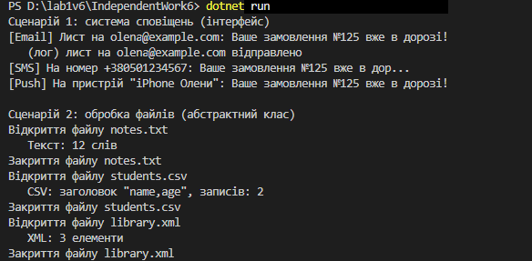

Самостійна робота №6
====================

## Тема
Інтерфейс vs абстрактний клас — практичні критерії.

## Мета
 Поглибити розуміння відмінностей між інтерфейсами та абстрактними класами, а також розробити практичні критерії для вибору найбільш підходящого підходу в різних сценаріях проєктування.

## Хід роботи

1. **Створено консольний проєкт:** `dotnet new console -o IndependentWork6`
2. **Сценарій 1 — система сповіщень (інтерфейс):**
   * Створено інтерфейси `INotifier` (метод `Send`, властивість `ChannelName`) та `ILogger`.
   * Реалізовано класи `EmailNotifier` (реалізує обидва інтерфейси), `SmsNotifier` і `PushNotifier`.
3. **Сценарій 2 — обробка файлів (абстрактний клас):**
   * Створено абстрактний клас `FileProcessor` зі спільними кроками `Open()` і `Close()`, шаблонним методом `Process()` та абстрактним методом `ProcessContent()`.
   * Реалізовано класи `TextFileProcessor`, `CsvFileProcessor` та `XmlFileProcessor`.
4. **Демонстрація роботи в `Main`:**
   * Для кожного сценарію створено колекцію базового типу (`List<INotifier>`, `List<FileProcessor>`), додано об'єкти всіх реалізацій і в циклі викликано спільний метод.


## Фотозвіт


## Сценарій 1: Система сповіщень

### Обраний підхід: Інтерфейс `INotifier`

### Обґрунтування вибору:

У цьому сценарії краще використовувати інтерфейс `INotifier`, оскільки:

1. **Різні базові типи:** класи `EmailNotifier`, `SmsNotifier`, `PushNotifier` не мають спільних даних чи спільної реалізації. Email потрібна адреса, SMS — номер телефону й обрізання довгого тексту, Push — назва пристрою. Їх об'єднує лише вміння `Send(string message)`, тобто зв'язок «може робити» (can-do).
2. **Множинна поведінка:** клас може бути не тільки сповіщувачем, але й логером. `EmailNotifier` реалізує одночасно `INotifier` та `ILogger`. З абстрактним класом так зробити не вийшло б, бо в C# можна мати лише один базовий клас.
3. **Слабке зв'язування:** клієнтський код працює з `List<INotifier>` і не знає, які саме канали в ньому є. Новий канал (наприклад, Telegram) можна додати, не змінюючи код відправки.

**Чому абстрактний клас тут менш доречний:** у нього не було б що винести в спільну реалізацію, бо кожен канал відправляє повідомлення повністю по-своєму. Натомість абстрактний клас забрав би в нащадків єдину можливість наслідування.

### Реалізація:

```csharp
public interface INotifier
{
    string ChannelName { get; }
    void Send(string message);
}

public class EmailNotifier : INotifier, ILogger
{
    private string _email;
    public void Send(string message)
    {
        Console.WriteLine($"[Email] Лист на {_email}: {message}");
        Log($"лист на {_email} відправлено");
    }
}

public class SmsNotifier : INotifier
{
    private string _phone;
    public void Send(string message)
    {
        string text = message.Length > 30 ? message.Substring(0, 30) + "..." : message;
        Console.WriteLine($"[SMS] На номер {_phone}: {text}");
    }
}

List<INotifier> notifiers = new List<INotifier>
{
    new EmailNotifier("olena@example.com"),
    new SmsNotifier("+380501234567"),
    new PushNotifier("iPhone Олени")
};

foreach (INotifier notifier in notifiers)
{
    notifier.Send("Ваше замовлення №125 вже в дорозі!");
}
```

---

## Сценарій 2: Обробка файлів

### Обраний підхід: Абстрактний клас `FileProcessor`

### Обґрунтування вибору:

У цьому сценарії краще використовувати абстрактний клас `FileProcessor`, оскільки:

1. **Спільні кроки:** відкриття й закриття файлу однакові для всіх типів, тож вони реалізовані один раз у базовому класі, і нащадкам не потрібно їх дублювати.
2. **Шаблонний метод:** метод `Process()` задає незмінний порядок «відкрити → обробити → закрити». Нащадки змінюють лише один крок — абстрактний `ProcessContent()`. Тому неможливо забути відкрити чи закрити файл.
3. **Спільний стан і конструктор:** усі обробники мають назву та вміст файлу. Ці поля й конструктор розміщено в базовому класі, а нащадки лише викликають `base(fileName, content)`. Інтерфейс не може мати полів і конструкторів.
4. **Зв'язок «є-різновидом»:** текстовий, CSV- і XML-обробник *є* обробниками файлів.

**Чому інтерфейс тут менш доречний:** інтерфейс описав би лише контракт `Process()`, і кожен клас мусив би сам повторювати код відкриття та закриття. Порядок кроків ніхто б не гарантував.

### Реалізація:

```csharp
public abstract class FileProcessor
{
    private string _fileName;
    private string _content;
    protected FileProcessor(string fileName, string content)
    {
        _fileName = fileName;
        _content = content;
    }
    public void Process()
    {
        Open();
        ProcessContent();
        Close();
    }

    private void Open()  { /* спільна логіка */ }
    private void Close() { /* спільна логіка */ }

    protected abstract void ProcessContent();
}

public class TextFileProcessor : FileProcessor
{
    public TextFileProcessor(string fileName, string content) : base(fileName, content) { }

    protected override void ProcessContent()
    {
        string[] words = Content.Split(new char[] { ' ', '\n' }, StringSplitOptions.RemoveEmptyEntries);
        Console.WriteLine($"   Текст: {words.Length} слів");
    }
}

public class CsvFileProcessor : FileProcessor
{
    public CsvFileProcessor(string fileName, string content) : base(fileName, content) { }

    protected override void ProcessContent()
    {
        string[] lines = Content.Split('\n', StringSplitOptions.RemoveEmptyEntries);
        Console.WriteLine($"   CSV: заголовок \"{lines[0]}\", записів: {lines.Length - 1}");
    }
}

List<FileProcessor> processors = new List<FileProcessor>
{
    new TextFileProcessor("notes.txt", "..."),
    new CsvFileProcessor("students.csv", "name,age\nОлена,19\nАндрій,20"),
    new XmlFileProcessor("library.xml", "<library><book>Кобзар</book>...</library>")
};

foreach (FileProcessor processor in processors)
{
    processor.Process();
}
```

## Загальні висновки

| Критерій | Інтерфейс | Абстрактний клас |
| --- | --- | --- |
| Спільна реалізація | немає | є (`Open`, `Close`) |
| Поля й конструктор | немає | є |
| Кількість у класі | багато (`INotifier`, `ILogger`) | лише один базовий клас |
| Зв'язок | «може робити» | «є-різновидом» |
| Мій сценарій | сповіщення | обробка файлів |

* **Інтерфейс** варто обирати, коли класи різні й не мають спільного коду, а об'єднує їх лише вміння щось робити, або коли класу потрібно кілька ролей одночасно.
* **Абстрактний клас** варто обирати, коли нащадки мають спільні дані, конструктор і частину однакової логіки, особливо якщо є фіксована послідовність кроків (шаблонний метод).
* В обох сценаріях поліморфізм дозволяє працювати з усіма реалізаціями через одну колекцію базового типу й один виклик (`Send` або `Process`), а нові реалізації додаються без змін у клієнтському коді.

---

## Контрольні запитання

1. **Які ознаки підказують, що сценарій краще моделювати через інтерфейс?**
   * Класи не мають спільних даних і спільної реалізації; їх об'єднує лише вміння («може робити»); класу може знадобитися кілька ролей одночасно, як `EmailNotifier`, що є і `INotifier`, і `ILogger`.
2. **У чому перевага абстрактного класу для процесів зі спільними кроками виконання?**
   * Спільні кроки пишуться один раз, а порядок їх виконання задає шаблонний метод `Process()`. Нащадки реалізують лише свою частину (`ProcessContent()`) і не можуть порушити послідовність.
3. **Як порівняння двох підходів допомагає прийняти архітектурне рішення?**
   * Порівнюючи критерії (спільний код, поля, множинність, тип зв'язку), можна заздалегідь побачити, який підхід дасть менше дублювання й більше гнучкості, а не з'ясовувати це, коли код уже написаний.
4. **Яку роль у ваших прикладах відіграє поліморфізм?**
   * `Main` працює з `List<INotifier>` і `List<FileProcessor>` і викликає один метод для всіх об'єктів, а виконується реалізація конкретного класу. Тому новий канал чи тип файлу можна додати без зміни циклу.
