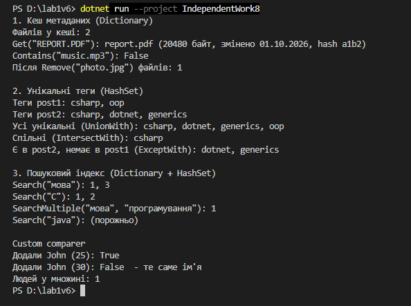

Самостійна робота №8
====================

## Тема
Вивчення `Dictionary<TKey, TValue>` та `HashSet<T>` у бібліотеках .NET.

## Мета
Дослідити реальні приклади використання узагальнених колекцій у популярних .NET-бібліотеках та зрозуміти, як вони застосовуються для вирішення практичних задач.

## Хід роботи

1. **Створено консольний проєкт:** `dotnet new console -o IndependentWork8`
2. **Проаналізовано open-source проєкти:**
   * Знайдено приклади в **Serilog** (`Dictionary`), **Newtonsoft.Json** (`HashSet`) та **Dapper** (обидві колекції разом).
3. **Реалізовано три сценарії:**
   * **`FileMetadataCache`** — кеш метаданих на `Dictionary` з методами `Add`, `Get`, `Remove`, `Contains`.
   * **`TagManager`** — теги статей на `HashSet` з `UnionWith`, `IntersectWith`, `ExceptWith`.
   * **`SearchIndex`** — інвертований індекс `Dictionary<string, HashSet<int>>` з пошуком за одним і кількома словами.
4. **Додатково:** показано custom comparer (`StringComparer.OrdinalIgnoreCase` і власний `PersonNameComparer`).
5. **Складено порівняльну таблицю** складності операцій `List`, `Dictionary`, `HashSet` (у звіті).

## Фотозвіт

---

## Контрольні запитання

1. **Які переваги generic-колекцій над неузагальненими структурами даних у .NET?**
   * Безпека типів (помилки видно під час компіляції), немає приведення з `object` і упаковки для типів-значень, тому код швидший і чистіший.
2. **У яких сценаріях доцільніше використовувати `Dictionary<TKey, TValue>`, а в яких — `HashSet<T>`?**
   * `Dictionary` — коли за ключем треба отримати значення (кеш, налаштування, параметри). `HashSet` — коли важливі лише унікальні значення й швидка перевірка «чи є» (теги, вже оброблені елементи).
3. **Як `IEqualityComparer<T>` впливає на коректність і продуктивність `Dictionary` та `HashSet`?**
   * Він визначає, які елементи вважаються однаковими (наприклад, без урахування регістру). Якщо `GetHashCode()` погано розподіляє значення, багато елементів потрапляють в одну «комірку», і пошук сповільнюється з O(1) до O(n).
4. **Чому інвертований індекс зручно будувати саме на базі `Dictionary<string, HashSet<int>>`?**
   * `Dictionary` за O(1) знаходить слово, а `HashSet` зберігає документи без повторів і дозволяє одразу знайти документи з усіма словами через `IntersectWith`.
