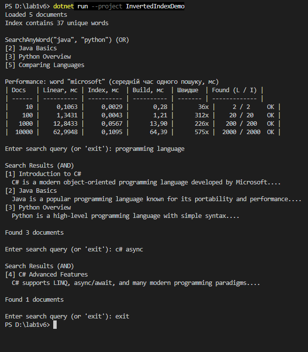

Самостійна робота №10
=====================

## Тема
Колекції в практиці ООП: інвертований індекс і вимірювання продуктивності.

## Мета
Розробити власну реалізацію інвертованого індексу для повнотекстового пошуку та порівняти продуктивність різних підходів до пошуку в колекціях.

## Хід роботи

1. **Створено консольний проєкт:** `dotnet new console -o InvertedIndexDemo`
2. **Реалізовано класи:**
   * **`Document`** — документ з `Id`, `Title`, `Content`.
   * **`TextProcessor`** — `Tokenize()` через `Regex`, `RemoveStopWords()` і спільний `Normalize()`.
   * **`InvertedIndex`** — `Dictionary<string, HashSet<int>>` з методами `SearchSingleWord`, `SearchMultipleWords` (`IntersectWith`) та `SearchAnyWord` (`UnionWith`).
   * **`PerformanceTest`** — генерація 10/100/1000/10000 документів і порівняння лінійного пошуку з індексом.
3. **Зроблено інтерактивний пошук** у консолі (AND-пошук за кількома словами).

---

##  Фотозвіт

## Контрольні запитання

1. **Чому структура `Dictionary<string, HashSet<int>>` добре підходить для реалізації інвертованого індексу?**
   * `Dictionary` за O(1) знаходить слово, а `HashSet<int>` зберігає id документів без повторів, навіть якщо слово зустрічається в документі кілька разів.
2. **Які переваги `HashSet<T>` дає під час обчислення AND/OR-пошуку за кількома словами?**
   * Є готові операції над множинами: `IntersectWith` для AND і `UnionWith` для OR. Вони працюють швидко й не створюють дублікатів, тож не треба писати вкладені цикли.
3. **Чому під час вимірювання продуктивності важливо однаково нормалізувати текст для лінійного пошуку та пошуку через індекс?**
   * Інакше способи знаходитимуть різні документи (наприклад, через регістр чи пунктуацію), і ми порівнюватимемо різну роботу. Порівняння коректне лише тоді, коли результати однакові.
4. **Які обмеження має проста реалізація інвертованого індексу без ранжування, стемінгу та підтримки фраз?**
   * Результати не впорядковані за релевантністю; різні форми слова (`language`/`languages`) вважаються різними словами; не можна шукати точну фразу з урахуванням порядку слів.

