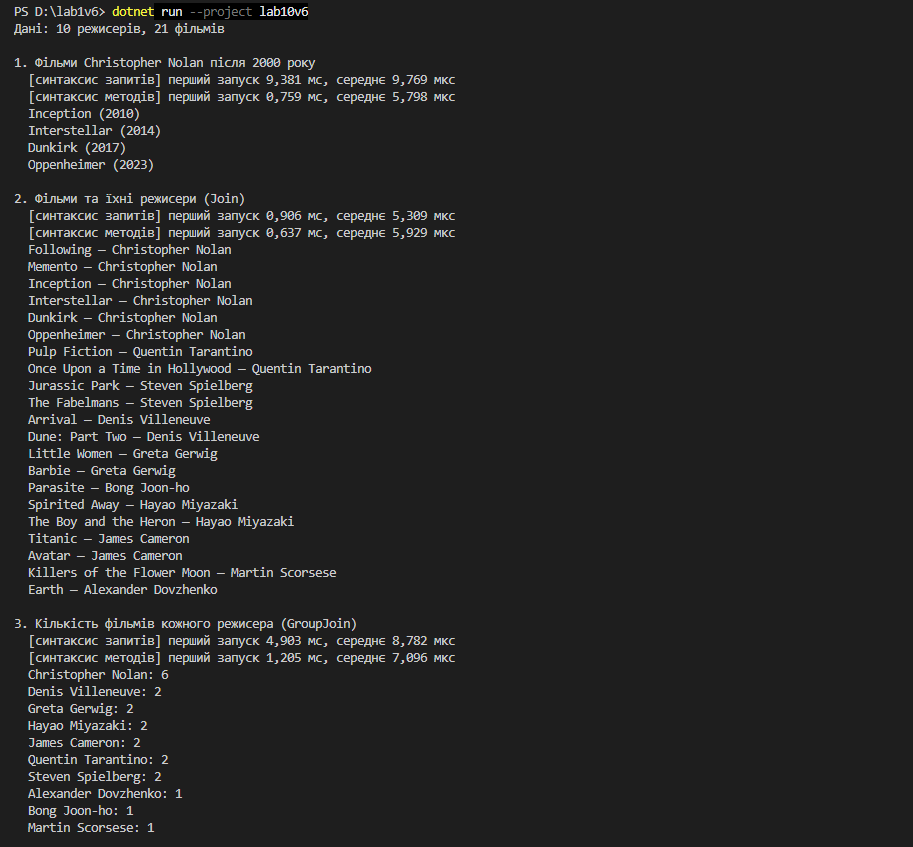
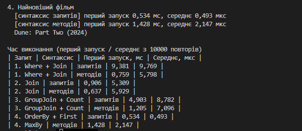

Лабораторна робота №10
======================

## Тема
LINQ в дії: фільтри, `join`, агрегації. Продуктивність.

## Мета
Навчитися писати LINQ-запити у синтаксисі запитів і синтаксисі методів, з'єднувати колекції через `Join` / `GroupJoin`, використовувати агрегатні функції та порівнювати продуктивність запитів за допомогою `Stopwatch`.

## Хід роботи

1. **Створено консольний проєкт:** `dotnet new console -o lab10v6`
2. **Описано сутності для варіанту «Фільмотека»:**
   * **`Director`** — режисер (`Id`, `Name`, `Country`).
   * **`Movie`** — фільм (`Id`, `Title`, `DirectorId`, `ReleaseYear`); `DirectorId` пов'язує фільм з режисером.
   * **`Data`** — тестові дані: 10 режисерів і 21 фільм.
3. **Написано запити, кожен у двох синтаксисах (клас `Queries`):**
   * **Запит 1 (`Where` + `Join`):** фільми Christopher Nolan, випущені після 2000 року.
   * **Запит 2 (`Join`):** список фільмів з іменами режисерів.
   * **Запит 3 (`GroupJoin` + `Count`):** кількість фільмів у кожного режисера, від більшої до меншої.
   * **Запит 4 (агрегація):** найновіший фільм — через `orderby` + `First()` і через `MaxBy()`.
4. **Виміряно продуктивність:** метод `Measure` через `Stopwatch` заміряє перший запуск (разом з JIT-компіляцією) і середній час одного виконання з 10 000 повторів. Наприкінці програма виводить таблицю часу.

### Час виконання

| Запит | Синтаксис | Перший запуск, мс | Середнє, мкс |
| --- | --- | --- | --- |
| 1. Where + Join | запитів | 9,381 | 9,769 |
| 1. Where + Join | методів | 0,759 | 5,798 |
| 2. Join | запитів | 0,906 | 5,309 |
| 2. Join | методів | 0,637 | 5,929 |
| 3. GroupJoin + Count | запитів | 4,903 | 8,782 |
| 3. GroupJoin + Count | методів | 1,205 | 7,096 |
| 4. OrderBy + First | запитів | 0,534 | 0,493 |
| 4. MaxBy | методів | 1,428 | 2,147 |

## Фотозвіт

### Висновки
* Перший запуск у рази довший за середній, бо в нього входить JIT-компіляція. Найдовший перший запуск (9,381 мс) у першого запиту: на нього припала компіляція `Join`, `OrderBy` і лямбд. Наступні запити вже використовують скомпільований код, тому їхній перший запуск менше 1–5 мс.
* Синтаксис запитів і синтаксис методів компілюються в ті самі виклики методів. Тому в запиті 2 час майже однаковий (5,3 і 5,9 мкс). У запитах 1 і 3 синтаксис запитів трохи повільніший, бо він вимірювався першим, коли програма ще не повністю «розігрілася», а в запиті 3 `let` ще й створює додатковий проміжний об'єкт.
* Найдорожчі запити — з `Join` / `GroupJoin` і сортуванням (5–10 мкс): вони будують хеш-таблицю, створюють нові об'єкти й сортують результат.
* Пошук найновішого фільму виявився найшвидшим (0,5–2 мкс), бо тут немає з'єднання таблиць. `OrderBy` + `First` тут навіть швидший за `MaxBy`: .NET оптимізує цю пару й не сортує весь список, а проходить його один раз. На 21 елементі різниця в 1–2 мкс — це дуже мало.

## Контрольні запитання

1. **Чим відрізняється синтаксис запитів від синтаксису методів?**
   * Синтаксис запитів схожий на SQL (`from`, `where`, `select`), його легше читати при `join` і групуванні. Синтаксис методів — це ланцюжок викликів з лямбдами (`.Where(...).Select(...)`), і в ньому є всі методи (`MaxBy`, `Count`, `Take` тощо). Компілятор зводить обидва до тих самих методів.
2. **У чому різниця між `Join` і `GroupJoin`?**
   * `Join` з'єднує пари «фільм — режисер», і кожна пара стає окремим рядком. `GroupJoin` до кожного режисера прикріплює групу його фільмів, тому можна одразу порахувати їхню кількість. Режисер без фільмів у `GroupJoin` теж залишиться, з порожньою групою.
3. **Наведіть приклади агрегатних функцій.**
   * `Count`, `Sum`, `Average`, `Min`, `Max`, `MinBy`/`MaxBy`, `Aggregate`. У лабі я рахую фільми режисера через `Count()` і шукаю найновіший фільм через `MaxBy()`.
4. **Як виміряти продуктивність запиту і що на неї впливає?**
   * Через `Stopwatch`: запускаю запит багато разів і рахую середній час, а перший запуск вважаю окремо, бо в ньому JIT. Запит треба матеріалізувати (`ToList()`, `First()`), інакше через відкладене виконання заміряється лише його створення. На час впливають кількість даних, сортування, `join`, створення нових об'єктів, режим збірки (Debug/Release) і навантаження комп'ютера.

