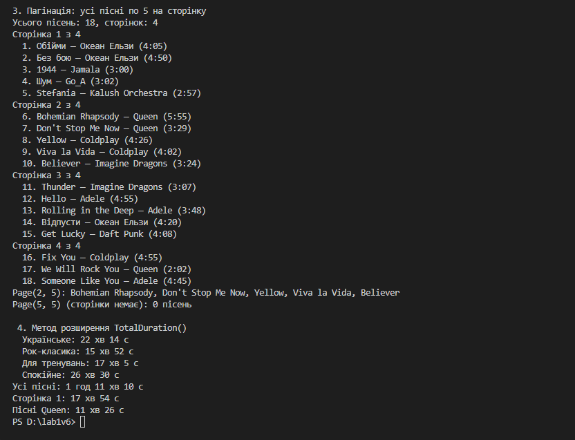

Лабораторна робота №11
======================

## Тема
LINQ: `SelectMany`, пагінація й custom extensions.

## Мета
Навчитися використовувати оператор `SelectMany` для роботи з вкладеними колекціями, реалізовувати пагінацію даних за допомогою LINQ, а також створювати власні методи розширення для `IEnumerable<T>`.

## Хід роботи

1. **Створено класи сутностей для варіанту «Плейлисти та пісні з виконавцями»:**
   * **`Artist`** — виконавець (`Id`, `Name`).
   * **`Song`** — пісня (`Id`, `Title`, `DurationSeconds`, `Artist`) і властивість `DurationText` для виводу у форматі `хв:сс`.
   * **`Playlist`** — плейлист (`Id`, `Name`) з вкладеною колекцією `List<Song>`.
   * **`Data`** — тестові дані: 9 виконавців, 18 пісень, 4 плейлисти (деякі пісні є в кількох плейлистах).
2. **Реалізовано запити:**
   * **`Select` vs `SelectMany`:** `Select` повертає 4 окремі списки пісень, а `SelectMany` розгортає їх в один список із 21 пісні.
   * **`SelectMany`:** усі унікальні виконавці з усіх плейлистів (`SelectMany` → `Select` → `DistinctBy`), а також той самий запит у синтаксисі запитів (два `from`).
   * **Пагінація:** усі пісні по 5 на сторінку через `Skip((page - 1) * pageSize).Take(pageSize)`, виведено всі 4 сторінки поспіль.
3. **Створено методи розширення:**
   * **`TotalDuration()`** для `IEnumerable<Song>` — загальна тривалість пісень (`TimeSpan`); застосовано до кожного плейлиста, до всіх пісень, до однієї сторінки і до результату `Where`.
   * **`ToReadable()`** для `TimeSpan` — вивід тривалості у вигляді «22 хв 14 с».
   * **`Page<T>()`** для `IEnumerable<T>` — узагальнена пагінація з перевіркою номера й розміру сторінки.

## Фотозвіт

## Контрольні запитання

1. **Для чого використовується оператор `SelectMany`? Наведіть приклад, що демонструє його відмінність від `Select`.**
   * `SelectMany` бере з кожного елемента вкладену колекцію і зливає всі їх в один плаский список. `playlists.Select(p => p.Songs)` дає 4 окремі списки (список списків), а `playlists.SelectMany(p => p.Songs)` дає один список із 21 пісні, і по ньому вже можна шукати, фільтрувати й рахувати.
2. **Як реалізувати пагінацію даних за допомогою LINQ? Які методи для цього використовуються?**
   * Через `Skip` і `Take`: `Skip((page - 1) * pageSize)` пропускає пісні попередніх сторінок, а `Take(pageSize)` бере пісні поточної. Кількість сторінок рахується як `Math.Ceiling(count / (double)pageSize)`. Перед пагінацією дані краще відсортувати, щоб сторінки завжди були однакові.
3. **Поясніть концепцію методів розширення. Як вони інтегруються з LINQ?**
   * Це статичний метод у статичному класі, де перший параметр має `this`. Він «додає» новий метод до типу, не змінюючи сам тип, і викликається як звичайний: `songs.TotalDuration()`. Увесь LINQ (`Where`, `Select`, `Skip`…) — це теж методи розширення для `IEnumerable<T>`, тому мої методи працюють з ними в одному ланцюжку: `allSongs.Where(...).TotalDuration()`.
4. **Наведіть приклад власного методу розширення для `IEnumerable<T>` та поясніть його призначення.**
   * `Page<T>(this IEnumerable<T> source, int pageNumber, int pageSize)` повертає потрібну сторінку будь-якої колекції. Він ховає формулу `Skip`/`Take` і перевіряє, що номер і розмір сторінки не менші за 1. Наприклад, `allSongs.Page(2, 5)` дає пісні з 6-ї по 10-ту.
