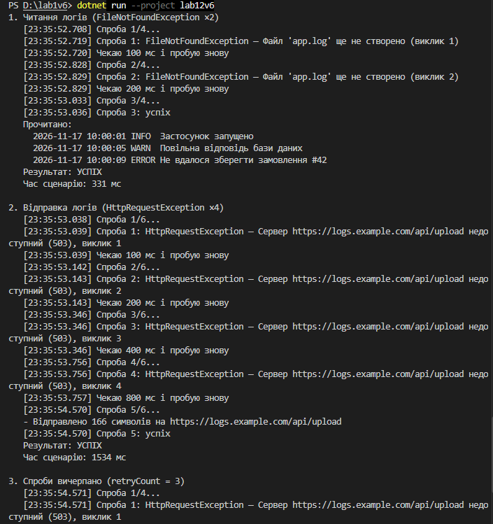
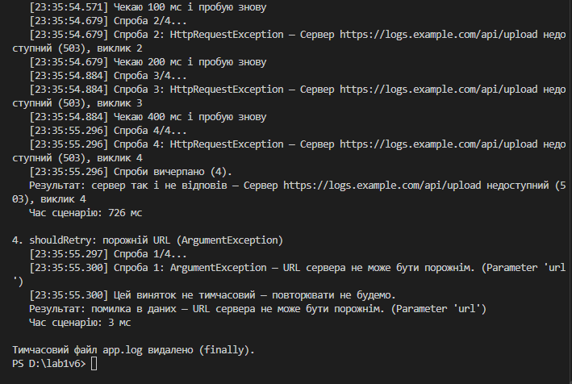

Лабораторна робота №12
======================
## Тема
Обробка IO/мережевих помилок та патерн Retry.

## Мета
Навчитися обробляти типові помилки вводу/виводу та мережеві помилки за допомогою блоків `try-catch-finally`, а також реалізувати патерн Retry для підвищення відмовостійкості застосунків.

## Хід роботи

1. **Створено консольний проєкт:** `dotnet new console -o lab12v6`
2. **Реалізовано класи за варіантом 6 «Відправка логів»:**
   * **`FileProcessor`:** метод `string GetLogContent(string path)` перші 2 рази кидає `FileNotFoundException`, потім читає файл через `File.ReadAllText`.
   * **`NetworkClient`:** метод `void SendLogToServer(string url, string logContent)` перші 4 рази кидає `HttpRequestException`, потім «відправляє» лог; для порожнього URL кидає `ArgumentException`.
3. **Реалізовано `RetryHelper`:**
   * **`ExecuteWithRetry<T>(Func<T>, retryCount, initialDelay, shouldRetry)`** повторює операцію, поки вона не вдасться або не скінчаться спроби.
   * **Експоненційна затримка:** `initialDelay * 2^(спроба - 1)`, тобто 100 → 200 → 400 → 800 мс.
   * **Логування:** кожна спроба з часом, типом винятку і причиною.
   * **`shouldRetry`:** якщо повертає `false`, виняток одразу кидається далі без повторів.
   * **Перевантаження для `Action`** — для `void`-методу `SendLogToServer`.
4. **Сценарії в `Main`** (`shouldRetry` = `FileNotFoundException` або `HttpRequestException`):
   * **читання логів:** 2 невдачі → успіх на 3-й спробі;
   * **відправка логів:** 4 невдачі → успіх на 5-й спробі;
   * **спроби вичерпано:** 4 невдачі при `retryCount = 3`;
   * **`ArgumentException`:** не повторюється, бо `shouldRetry` повертає `false`.
5. **`try-catch-finally`:** у `RunScenario` `finally` завжди виводить час сценарію, а в `Main` видаляє тимчасовий файл `app.log`.

## Фотозвіт

### Висновок

Експоненційна затримка подвоює паузу після кожної невдалої спроби: `100 × 2^(n-1)` мс, тобто 100, 200, 400, 800 мс. У моєму варіанті сервер «оживає» після 4 невдач, тому загальне очікування — 1500 мс. Так програма не засипає сервер запитами, але й не здається одразу, а `shouldRetry` не дає марно повторювати постійні помилки, як-от порожній URL.
## Контрольні запитання

1. **Які типи винятків найчастіше виникають при роботі з файлами та мережею?**
   * Файли: `FileNotFoundException`, `DirectoryNotFoundException`, `IOException`, `UnauthorizedAccessException`. Мережа: `HttpRequestException`, `SocketException`, `TimeoutException`.
2. **Поясніть принцип роботи патерну Retry. Коли його доцільно використовувати?**
   * Операцію повторюють кілька разів, якщо помилка тимчасова. Доцільно для мережі, зайнятого файлу чи бази, але не для помилок у даних.
3. **Як реалізувати експоненційну затримку між повторними спробами?**
   * `delay = initialDelay * 2^(attempt - 1)` і `Thread.Sleep(delay)` перед наступною спробою.
4. **Для чого потрібен делегат `shouldRetry` у допоміжному класі `RetryHelper`?**
   * Він вирішує, які винятки повторювати. Тимчасові (`HttpRequestException`) — так, постійні (`ArgumentException`) — ні, щоб не гаяти час.
