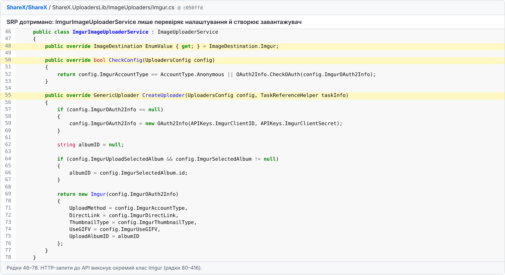
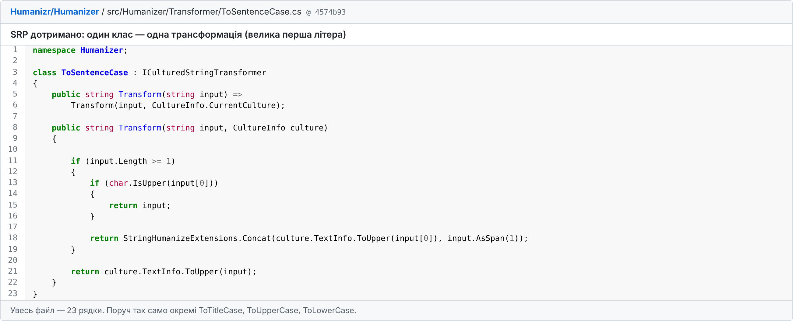
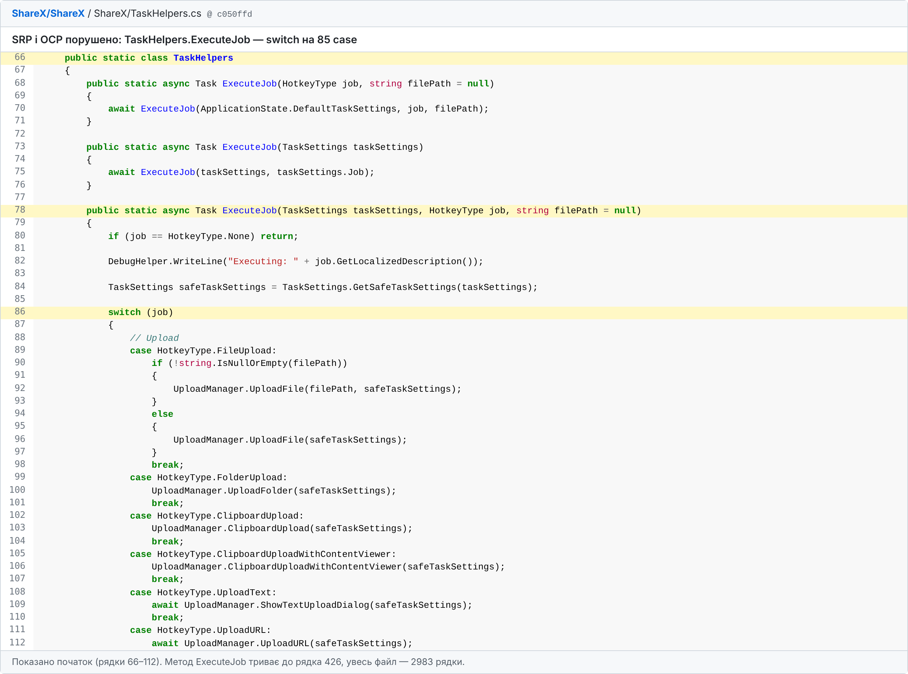
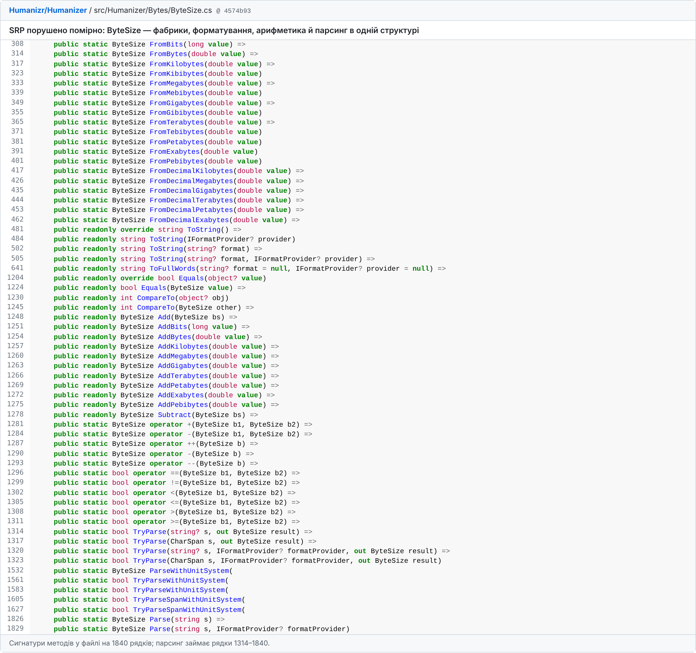
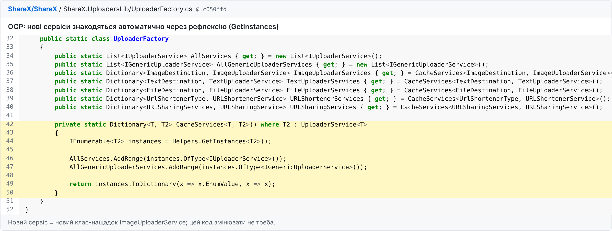
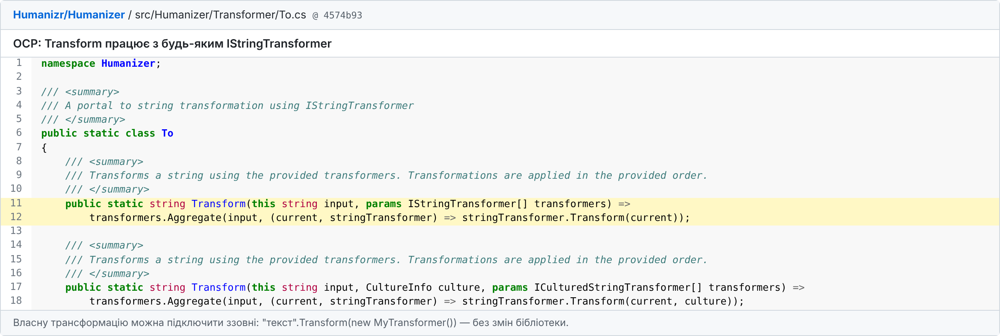

Лабораторна робота №14
======================
## Тема
Аналіз SRP/OCP у відкритих репозиторіях.

## Мета
Дослідити, як принципи SRP та OCP застосовуються в реальних проєктах, і підготувати короткий практичний аналіз прикладів рефакторингу.

## Хід роботи

1. **Обрано 2 open-source репозиторії на C# з різних доменів:**
   * **[ShareX](https://github.com/ShareX/ShareX)** — десктоп-застосунок для скриншотів;
   * **[Humanizer](https://github.com/Humanizr/Humanizer)** — бібліотека форматування тексту.
2. **Знайдено приклади з посиланнями на файли й рядки:**
   * **SRP дотримано:** `ImgurImageUploaderService` / `Imgur` (ShareX), `ToSentenceCase` (Humanizer).
   * **SRP порушено:** `TaskHelpers` (ShareX, ~3000 рядків), `ByteSize` (Humanizer, 1840 рядків).
   * **OCP:** сервіси завантаження через `UploaderFactory` (ShareX), `IStringTransformer` і `LocaliserRegistry` (Humanizer).
3. **Проаналізовано кожен приклад:** де видно принцип, ризики й переваги, що зміниться при додаванні нової функції.
4. **Запропоновано рефакторинг** найгіршого прикладу (`TaskHelpers.ExecuteJob`, `switch` на 85 `case`) через патерн «Команда» з реєстром дій.

## Результат
Повний звіт із посиланнями, аналізом, рефакторингом і висновками — у [`REPORT.md`](REPORT.md).

Скріншоти проаналізованих фрагментів коду (з номерами рядків і комітом) лежать у папці [`screenshots`](screenshots) і вставлені у звіт біля кожного прикладу:

| Принцип | ShareX | Humanizer |
| --- | --- | --- |
| SRP дотримано |  |  |
| SRP порушено |  |  |
| OCP |  |  |

## Контрольні запитання

1. **Як відрізнити окрему відповідальність класу від просто великого обсягу коду?**
   * Порахувати причини для змін. `ByteSize` великий, але це один тип даних; `TaskHelpers` змінюють через UI, файли, запис екрана — це різні відповідальності.
2. **Які ознаки в коді найкраще підтверджують дотримання OCP?**
   * Абстракції (інтерфейс, абстрактний клас) і точка розширення, куди додається новий клас без правок: реєстр, фабрика з рефлексією, стратегія.
3. **Чому для аналізу SRP/OCP важливо дивитися не лише на інтерфейси, а й на місця розширення системи?**
   * Інтерфейс сам нічого не гарантує: у ShareX є абстракції, але новий сервіс усе одно вимагає правити enum і конфіг. Реальну картину видно лише за тим, скільки старого коду доводиться змінювати.
4. **Які ризики виникають, якщо застосовувати рефакторинг «під патерн» без реальної потреби?**
   * Зайві класи й складність, код важче читати, а користі немає, бо ця частина рідко змінюється.
