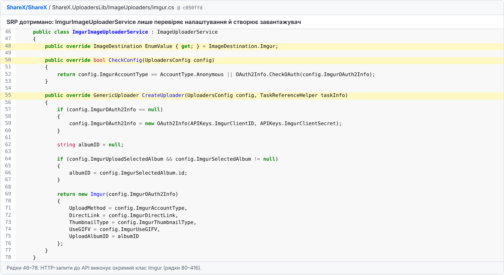
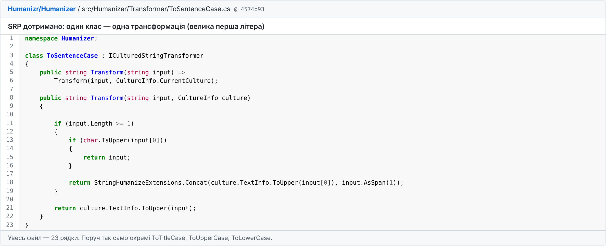
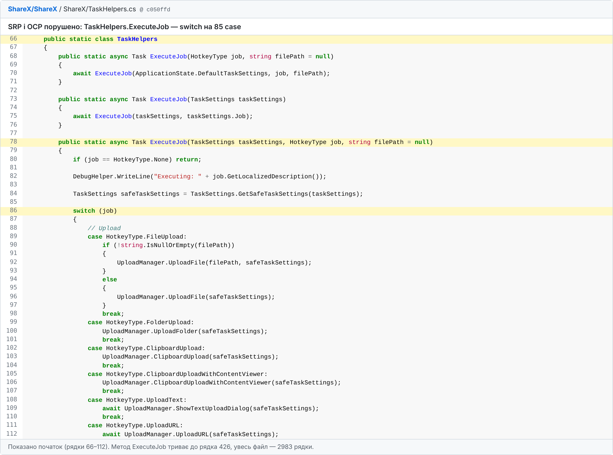
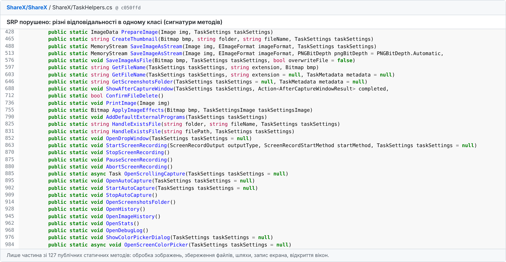
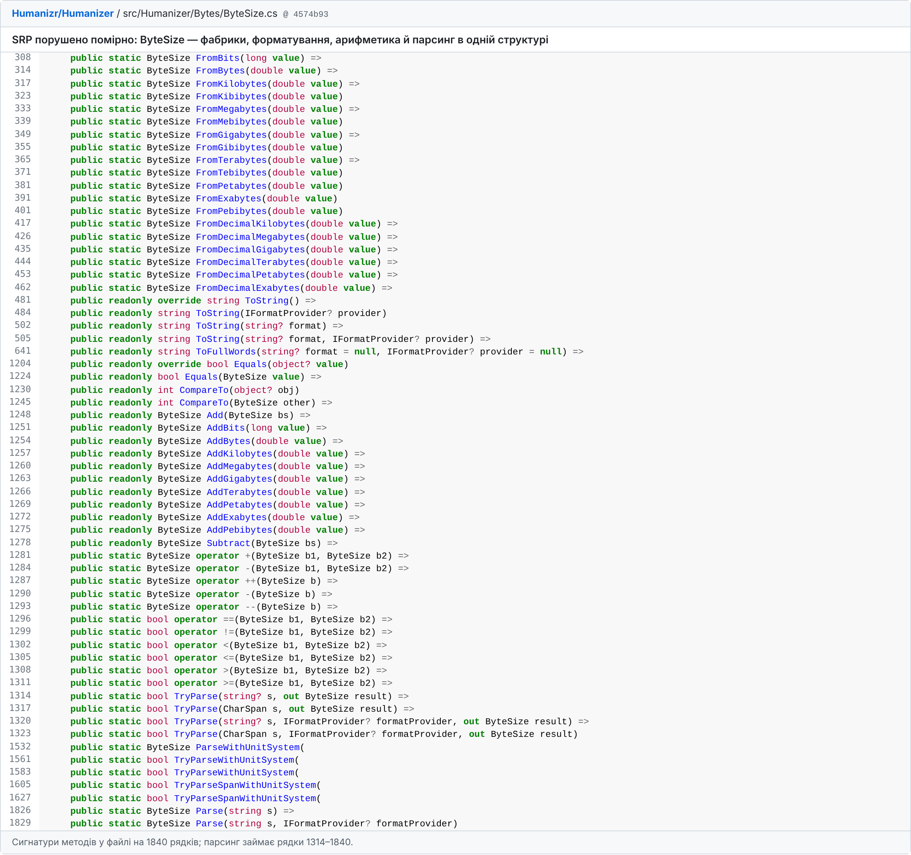
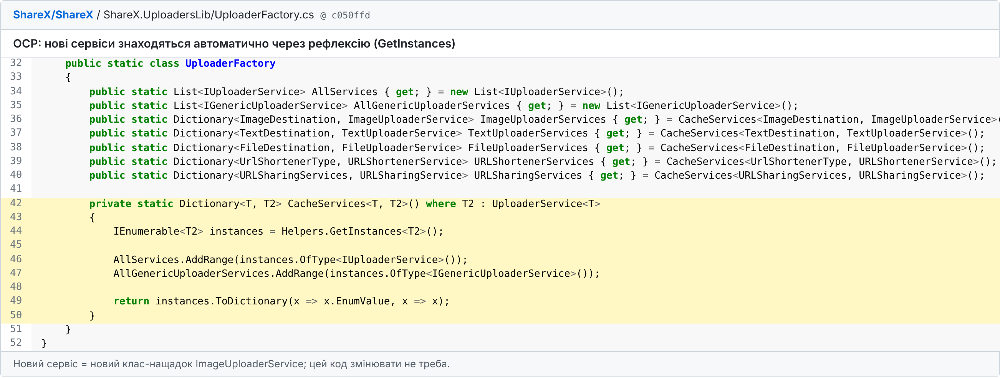
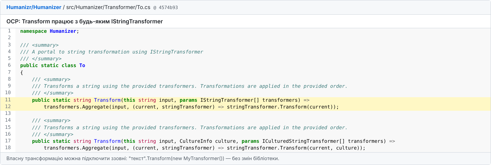
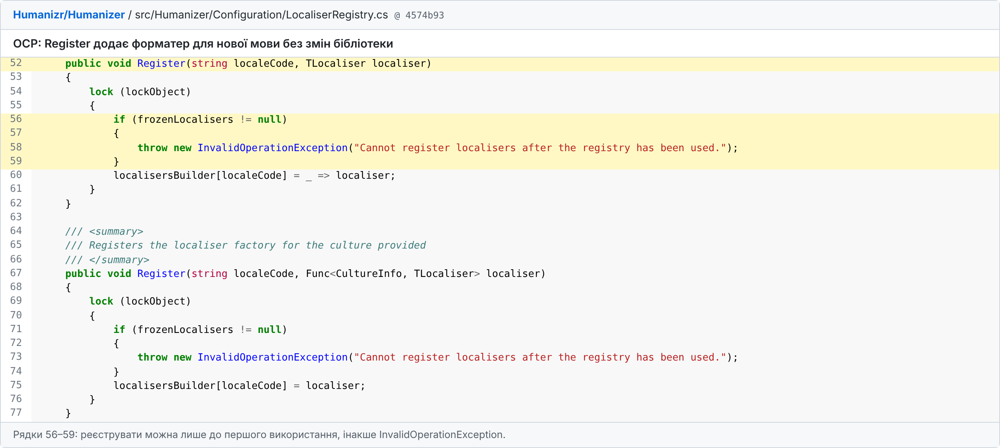

# Звіт: аналіз SRP та OCP у відкритих репозиторіях

## Обрані репозиторії

| Репозиторій | Домен | Коміт, на якому робився аналіз |
| --- | --- | --- |
| [ShareX/ShareX](https://github.com/ShareX/ShareX) | десктоп-застосунок для скриншотів і завантаження файлів | [`c050ffd`](https://github.com/ShareX/ShareX/tree/c050ffd26a72b7969b95cedefe69f71352a89e67) |
| [Humanizr/Humanizer](https://github.com/Humanizr/Humanizer) | бібліотека для «людського» форматування рядків, дат, чисел | [`4574b93`](https://github.com/Humanizr/Humanizer/tree/4574b93883bf48e3f0f3bca73297054537317ab2) |

**SRP** (Single Responsibility) — у класу має бути одна причина для змін.
**OCP** (Open/Closed) — систему розширюють новим кодом, не змінюючи старий.

## 1. Вдале застосування SRP

### 1.1. ShareX — опис сервісу окремо від самого завантаження

**Код:** [`Imgur.cs` L46–L78](https://github.com/ShareX/ShareX/blob/c050ffd26a72b7969b95cedefe69f71352a89e67/ShareX.UploadersLib/ImageUploaders/Imgur.cs#L46-L78) (`ImgurImageUploaderService`) і [`Imgur.cs` L80–L416](https://github.com/ShareX/ShareX/blob/c050ffd26a72b7969b95cedefe69f71352a89e67/ShareX.UploadersLib/ImageUploaders/Imgur.cs#L80-L416) (`Imgur`)




```csharp
public class ImgurImageUploaderService : ImageUploaderService
{
    public override ImageDestination EnumValue { get; } = ImageDestination.Imgur;

    public override bool CheckConfig(UploadersConfig config) { ... }

    public override GenericUploader CreateUploader(UploadersConfig config, TaskReferenceHelper taskInfo)
    {
        ...
        return new Imgur(config.ImgurOAuth2Info) { UploadMethod = ..., DirectLink = ... };
    }
}
```

* **Де видно принцип:** `ImgurImageUploaderService` лише перевіряє налаштування і створює завантажувач. Самі HTTP-запити до API робить окремий клас `Imgur`.
* **Переваги:** якщо Imgur змінить API, правиться лише `Imgur`; якщо змінюється спосіб вибору сервісу в програмі — лише клас-сервіс.
* **Ризики:** сам `Imgur` усе ж поєднує авторизацію OAuth, роботу з альбомами й завантаження, тож усередині він не ідеальний.
* **Нова функція** (наприклад, новий параметр Imgur) торкнеться тільки цих двох класів, а решту програми не зачепить.

### 1.2. Humanizer — одна трансформація = один клас

**Код:** [`ToSentenceCase.cs` L1–L23](https://github.com/Humanizr/Humanizer/blob/4574b93883bf48e3f0f3bca73297054537317ab2/src/Humanizer/Transformer/ToSentenceCase.cs#L1-L23)




```csharp
class ToSentenceCase : ICulturedStringTransformer
{
    public string Transform(string input, CultureInfo culture)
    {
        if (input.Length >= 1)
        {
            if (char.IsUpper(input[0])) return input;
            return StringHumanizeExtensions.Concat(culture.TextInfo.ToUpper(input[0]), input.AsSpan(1));
        }
        return culture.TextInfo.ToUpper(input);
    }
}
```

* **Де видно принцип:** клас робить рівно одне — першу літеру велику. Поруч так само окремі `ToTitleCase`, `ToUpperCase`, `ToLowerCase`.
* **Переваги:** класи маленькі, їх легко прочитати й протестувати окремо; помилка в одному перетворенні не ламає інші.
* **Ризики:** практично немає; хіба що класів багато, але кожен простий.
* **Нова функція** (новий регістр) — це новий маленький клас, а не правка великого.

---

## 2. Порушення SRP

### 2.1. ShareX — `TaskHelpers`: статичний клас на ~3000 рядків (найгірший приклад)

**Код:** [`TaskHelpers.cs` L66](https://github.com/ShareX/ShareX/blob/c050ffd26a72b7969b95cedefe69f71352a89e67/ShareX/TaskHelpers.cs#L66) (оголошення класу), [`ExecuteJob` L78–L426](https://github.com/ShareX/ShareX/blob/c050ffd26a72b7969b95cedefe69f71352a89e67/ShareX/TaskHelpers.cs#L78-L426)






```csharp
public static class TaskHelpers
{
    public static async Task ExecuteJob(TaskSettings taskSettings, HotkeyType job, string filePath = null)
    {
        switch (job)
        {
            case HotkeyType.FileUpload: ...
            case HotkeyType.FolderUpload: ...
            // ... ще ~80 case
            case HotkeyType.ExitShareX: ApplicationLifecycle.ForceClose(); break;
        }
    }

    public static ImageData PrepareImage(...)        
    public static void SaveImageAsFile(...)          
    public static string GetScreenshotsFolder(...)   
    public static void StartScreenRecording(...)     
    public static void OpenHashCheck(...)         
    public static bool StripMetadata(...)         
    ...
}
```

* **Де видно порушення:** 2983 рядки, а в одному класі зібрано обробку гарячих клавіш (`switch` з 85 `case`), збереження зображень, імена файлів, запис екрана, метадані й відкриття десятків вікон. Причин для змін — десятки.
* **Ризики:** будь-яка правка зачіпає величезний файл, тому часто виникають конфлікти в Git; статичні методи важко тестувати й підмінити; новачку складно зорієнтуватися.
* **Ще й порушення OCP:** щоб додати нову дію на гарячу клавішу, треба дописати `case` у `ExecuteJob`, тобто змінити старий код.
* **Нова функція** (новий інструмент) — це ще один метод і ще один `case` у той самий клас, і він росте далі.

### 2.2. Humanizer — `ByteSize`: одна структура робить усе

**Код:** [`ByteSize.cs`](https://github.com/Humanizr/Humanizer/blob/4574b93883bf48e3f0f3bca73297054537317ab2/src/Humanizer/Bytes/ByteSize.cs) (1840 рядків):
* [фабрики `From...` L308–L462](https://github.com/Humanizr/Humanizer/blob/4574b93883bf48e3f0f3bca73297054537317ab2/src/Humanizer/Bytes/ByteSize.cs#L308-L462);
* [форматування `ToString` L481–L508](https://github.com/Humanizr/Humanizer/blob/4574b93883bf48e3f0f3bca73297054537317ab2/src/Humanizer/Bytes/ByteSize.cs#L481-L508);
* [оператори L1281–L1293](https://github.com/Humanizr/Humanizer/blob/4574b93883bf48e3f0f3bca73297054537317ab2/src/Humanizer/Bytes/ByteSize.cs#L1281-L1293);
* [парсинг L1314–L1840](https://github.com/Humanizr/Humanizer/blob/4574b93883bf48e3f0f3bca73297054537317ab2/src/Humanizer/Bytes/ByteSize.cs#L1314-L1840).




* **Де видно порушення:** одна структура зберігає значення, переводить одиниці, рахує (`+`, `-`), форматує в рядок і понад 500 рядків розбирає текст (`Parse`, `TryParse`, `ParseWithUnitSystem`).
* **Пом'якшення:** для value-типу частина цього природна (оператори, `ToString`), тож порушення помірне, на відміну від `TaskHelpers`.
* **Ризики:** зміна правил парсингу (нова одиниця, новий формат) вимагає правити великий файл, де лежить і арифметика; легко випадково зачепити інше.
* **Нова функція** (наприклад, нова одиниця) змінює одразу фабрики, форматування й парсинг в одному файлі. Логіку парсингу варто винести в окремий `ByteSizeParser`.

---

## 3. Розширення за OCP

### 3.1. ShareX — нові сервіси завантаження через спадкування й рефлексію

**Код:** [`UploaderService.cs` L31–L46](https://github.com/ShareX/ShareX/blob/c050ffd26a72b7969b95cedefe69f71352a89e67/ShareX.UploadersLib/BaseServices/UploaderService.cs#L31-L46), [`ImageUploaderService.cs` L28–L31](https://github.com/ShareX/ShareX/blob/c050ffd26a72b7969b95cedefe69f71352a89e67/ShareX.UploadersLib/BaseServices/ImageUploaderService.cs#L28-L31), [`UploaderFactory.cs` L42–L50](https://github.com/ShareX/ShareX/blob/c050ffd26a72b7969b95cedefe69f71352a89e67/ShareX.UploadersLib/UploaderFactory.cs#L42-L50)




```csharp
public abstract class ImageUploaderService : UploaderService<ImageDestination>, IGenericUploaderService
{
    public abstract GenericUploader CreateUploader(UploadersConfig config, TaskReferenceHelper taskInfo);
}

private static Dictionary<T, T2> CacheServices<T, T2>() where T2 : UploaderService<T>
{
    IEnumerable<T2> instances = Helpers.GetInstances<T2>(); 
    ...
    return instances.ToDictionary(x => x.EnumValue, x => x);
}
```

* **Де видно принцип:** щоб додати новий сервіс, достатньо створити клас-нащадок `ImageUploaderService`. `UploaderFactory` сам знайде його через рефлексію (`GetInstances<T2>()`), і правити фабрику не треба. Так зроблено 67 сервісів.
* **Переваги:** код існуючих завантажувачів не змінюється, тому їх не можна зламати, додаючи новий.
* **Ризики й обмеження:** OCP дотримано не до кінця. Новий сервіс усе одно вимагає нового значення в [`ImageDestination`](https://github.com/ShareX/ShareX/blob/c050ffd26a72b7969b95cedefe69f71352a89e67/ShareX.UploadersLib/Enums.cs#L32-L48) і нових властивостей у [`UploadersConfig`](https://github.com/ShareX/ShareX/blob/c050ffd26a72b7969b95cedefe69f71352a89e67/ShareX.UploadersLib/UploadersConfig.cs#L35), де вже 172 властивості для ~50 сервісів, тобто теж порушення SRP.
* **Нова функція** (новий хостинг) — це новий клас + 1 рядок enum + налаштування в конфігу.

### 3.2. Humanizer — власні трансформації й мови без зміни бібліотеки

**Код:** [`IStringTransformer.cs`](https://github.com/Humanizr/Humanizer/blob/4574b93883bf48e3f0f3bca73297054537317ab2/src/Humanizer/Transformer/IStringTransformer.cs#L6-L13), [`To.cs` L11–L12](https://github.com/Humanizr/Humanizer/blob/4574b93883bf48e3f0f3bca73297054537317ab2/src/Humanizer/Transformer/To.cs#L11-L12), [`LocaliserRegistry.cs` L52–L77](https://github.com/Humanizr/Humanizer/blob/4574b93883bf48e3f0f3bca73297054537317ab2/src/Humanizer/Configuration/LocaliserRegistry.cs#L52-L77), [`Configurator.cs` L16 і L107](https://github.com/Humanizr/Humanizer/blob/4574b93883bf48e3f0f3bca73297054537317ab2/src/Humanizer/Configuration/Configurator.cs#L16)






```csharp
public interface IStringTransformer
{
    string Transform(string input);
}

public static string Transform(this string input, params IStringTransformer[] transformers) =>
    transformers.Aggregate(input, (current, t) => t.Transform(current));
```

* **Де видно принцип:**
  * `To.Transform` працює з будь-яким `IStringTransformer`, тому можна написати власний (наприклад, транслітерацію) і викликати `"текст".Transform(new MyTranslit())` без жодної правки бібліотеки;
  * так само `Configurator.Formatters.Register("uk", ...)` додає форматер для нової мови;
  * `DateTimeHumanizeStrategy` — це стратегія, яку можна замінити своєю.
* **Переваги:** бібліотека розширюється ззовні, а її код лишається незмінним і протестованим.
* **Ризики:** реєструвати форматери можна лише до першого використання, інакше буде `InvalidOperationException` (L56–L59). Про це треба знати.
* **Нова функція** — новий клас, що реалізує інтерфейс, плюс одна реєстрація.


## 4. Пропозиція рефакторингу (найгірший приклад — `TaskHelpers.ExecuteJob`)

**Проблема:** `switch` на 85 випадків в одному методі: кожна нова дія вимагає змінювати метод (порушення OCP), а сам клас відповідає за все (порушення SRP).

**Рішення — патерн «Команда» + реєстр:** кожна дія стає окремим класом, а `ExecuteJob` лише знаходить потрібну команду в словнику.

```csharp
public interface IHotkeyAction
{
    HotkeyType Type { get; }
    Task ExecuteAsync(TaskSettings settings, string? filePath);
}

public class FileUploadAction : IHotkeyAction
{
    public HotkeyType Type => HotkeyType.FileUpload;

    public Task ExecuteAsync(TaskSettings settings, string? filePath)
    {
        if (!string.IsNullOrEmpty(filePath))
            UploadManager.UploadFile(filePath, settings);
        else
            UploadManager.UploadFile(settings);
        return Task.CompletedTask;
    }
}

public class HotkeyActionRegistry
{
    private readonly Dictionary<HotkeyType, IHotkeyAction> _actions;

    public HotkeyActionRegistry(IEnumerable<IHotkeyAction> actions) =>
        _actions = actions.ToDictionary(a => a.Type);

    public Task ExecuteAsync(HotkeyType type, TaskSettings settings, string? filePath = null) =>
        _actions.TryGetValue(type, out var action)
            ? action.ExecuteAsync(settings, filePath)
            : Task.CompletedTask;
}
```

**Що це дає:**
* нова дія = новий клас, а `ExecuteJob` більше не змінюється (OCP);
* кожну дію можна протестувати окремо;
* решту `TaskHelpers` варто розділити на `ImageSaveService` (збереження й імена файлів), `ScreenRecordingController` і `ToolWindowLauncher` (відкриття вікон).

ShareX уже використовує такий підхід для завантажувачів (`UploaderFactory`), тож рефакторинг зробить код однорідним. Робити його краще поступово, по групі `case` за раз, щоб нічого не зламати.


## 5. Висновки

1. Обидва проєкти дотримуються SRP і OCP там, де очікують розширення: сервіси завантаження в ShareX, трансформації й мови в Humanizer.
2. OCP найкраще видно не в самих інтерфейсах, а в точках розширення: рефлексія в `UploaderFactory`, `Register(...)` у `LocaliserRegistry`, `params IStringTransformer[]`.
3. OCP у ShareX дотримано частково: новий сервіс усе одно вимагає правити enum і великий `UploadersConfig`.
4. Великий файл ще не означає порушення SRP. `ByteSize` великий, але це один value-тип, тож порушення помірне. `TaskHelpers` порушує SRP по-справжньому, бо змішує непов'язані завдання.
5. Головна ознака порушення SRP — кілька різних причин змінювати клас (UI, файли, запис екрана), а не кількість рядків.
6. Порушення SRP і OCP часто йдуть разом: «клас про все» зазвичай містить великий `switch`.
7. Humanizer як бібліотека загалом краще структурований, ніж застосунок ShareX, бо його з самого початку проєктували для розширення іншими розробниками.
8. Рефакторинг варто робити там, де код справді часто змінюється (`ExecuteJob`), а не «під патерн» усюди.