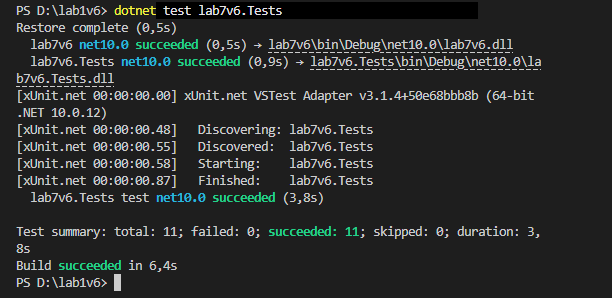
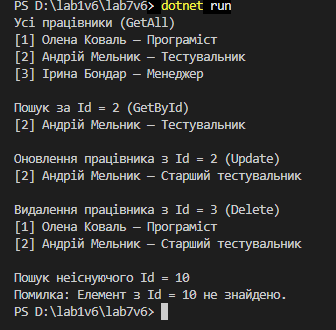

Лабораторна робота №7

## Тема

Узагальнені типи (Generics). `IRepository` з `where`-обмеженнями та тестами.

## Мета

> Навчитися створювати узагальнені інтерфейси та класи, застосовувати `where`-обмеження для типів-параметрів, а також розробляти юніт-тести для перевірки коректності узагальнених реалізацій.

## Хід роботи

1. **Створено консольний проєкт:** `dotnet new console -o OOP-Yakovets/lab12v6`
2. **Створено проєкт для тестів:** `dotnet new xunit -o OOP-Yakovets/lab12v6.Tests` та додано посилання на основний проєкт: `dotnet add reference ../lab12v6/lab12v6.csproj`
3. **Інтерфейси та реалізація:**
   * **`IEntity` (інтерфейс):** містить властивість `int Id { get; set; }`.
   * **`IRepository<T>` (узагальнений інтерфейс):** оголошує методи `GetById(int id)`, `GetAll()`, `Add(T item)`, `Update(T item)`, `Delete(int id)` з обмеженням `where T : IEntity`.
   * **`InMemoryRepository<T>` (реалізація):** зберігає дані у `List<T>` і реалізує всі CRUD-операції. Для неіснуючого `Id` методи `GetById`, `Update` та `Delete` кидають `KeyNotFoundException`, а `Add` з наявним `Id` — `ArgumentException`.
4. **Сутність за варіантом:**
   * **`Employee` (клас сутності):** реалізує `IEntity` і містить властивості `FirstName`, `LastName`, `Position`.
5. **Юніт-тести (`lab12v6.Tests`):**
   * Написано 11 тестів для методів `Add`, `GetById`, `GetAll`, `Update` та `Delete`, включно з перевіркою неіснуючих елементів.
   * Для перевірки використано `Assert.Equal`, `Assert.Single`, `Assert.Empty`, `Assert.Contains` та `Assert.Throws`.
6. **Демонстрація в `Main`:**
   * Створено `InMemoryRepository<Employee>`, додано трьох працівників, виконано пошук, оновлення та видалення, а результати виведено в консоль.

## Фотозвіт

![Результат dotnet test]

![Консольний вивід програми]

**Висновок:** узагальнений репозиторій працює з будь-яким типом, що реалізує `IEntity`, а всі CRUD-операції підтверджено юніт-тестами.

---

## Контрольні запитання

1. **Яка роль `where`-обмежень у Generics? Наведіть приклади їх використання.**
   * `where`-обмеження визначають, які типи можна підставити замість `T`, і дозволяють використовувати їхні члени всередині узагальненого коду.
   * **Приклад з роботи:** `where T : IEntity` гарантує, що в `T` є властивість `Id`, тому в репозиторії можна писати `item.Id == id`.
   * **Інші приклади:** `where T : class` (лише посилальні типи), `where T : struct` (лише типи-значення), `where T : new()` (є конструктор без параметрів).

2. **Навіщо потрібен шаблон `IRepository`? Які переваги він дає?**
   * Репозиторій відокремлює логіку доступу до даних від решти програми: код працює з інтерфейсом `IRepository<T>` і не знає, де зберігаються дані.
   * **Переваги:** сховище легко замінити (наприклад, `InMemoryRepository` на роботу з базою даних), один узагальнений клас підходить для всіх сутностей, а код зручно тестувати.

3. **Поясніть, чому юніт-тести є важливими при розробці узагальнених компонентів.**
   * Узагальнений клас використовується з багатьма типами, тому помилка в ньому впливає на всі сутності одразу.
   * Тести автоматично перевіряють кожну операцію, зокрема граничні випадки (неіснуючий `Id`, дублікат, `null`), і після змін у коді показують, чи нічого не зламалося.

4. **Які проблеми вирішують Generics порівняно з використанням `object`?**
   * **Безпека типів:** помилки виявляються під час компіляції, а не під час виконання.
   * **Немає приведення типів:** не потрібно писати `(Employee)obj`, отже, немає ризику `InvalidCastException`.
   * **Продуктивність:** для типів-значень немає упаковки й розпаковки (boxing/unboxing).
   * **Читабельність:** з `IRepository<Employee>` одразу зрозуміло, з якими даними працює код.
