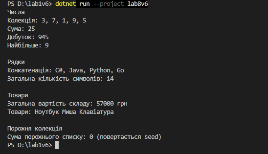

Лабораторна робота №8
=====================

## Тема
Делегати й лямбда-вирази у практиці колекцій: `CollectionHelper<T>`.

## Мета
Навчитися передавати поведінку як параметр через делегати `Func`, `Action`, `Predicate`, будувати на цій основі універсальні операції над колекціями та використовувати лямбда-вирази у практиці ООП.

## Хід роботи

1. **Створено консольний проєкт:** `dotnet new console -o lab8v6`
2. **Реалізовано клас `CollectionHelper<T>`:**
   * Статичний узагальнений клас з методом **`Aggregate<TAccumulate>(IEnumerable<T> collection, TAccumulate seed, Func<TAccumulate, T, TAccumulate> func)`**.
   * Метод власним циклом `foreach` проходить колекцію: починає з `seed` і на кожному кроці викликає делегат `func`, передаючи поточний результат і наступний елемент.
   * Для порожньої колекції повертає `seed`; якщо колекція чи делегат `null` — кидає `ArgumentNullException`.
3. **Демонстрація в `Main`:**
   * `List<int>` — сума, добуток і максимум.
   * `List<string>` — конкатенація рядків і загальна кількість символів.
   * `List<Product>` — загальна вартість складу (`Price * Quantity`) і список назв.
   * Порожній список — перевірка граничного випадку.

## Фотозвіт

---

## Контрольні запитання

1. **Що таке делегат і для чого він використовується?**
   * Це тип, у змінній якого зберігається посилання на метод. Завдяки цьому метод можна передати як параметр: у моїй лабі `Aggregate` отримує через делегат `func` інструкцію, *як* поєднувати елементи.
2. **У чому полягає різниця між `Func` та `Action`?**
   * `Func` повертає значення (останній тип у дужках — тип результату), а `Action` нічого не повертає. Тому в `Aggregate` використано `Func`: кожен крок повертає новий проміжний результат.
3. **Як лямбда-вирази спрощують роботу з делегатами?**
   * Не треба оголошувати окремий метод: логіку пишемо прямо при виклику, наприклад `(acc, x) => acc + x`. Один і той самий `Aggregate` рахує суму, добуток чи склеює рядки, залежно від переданої лямбди.
4. **Які переваги дають узагальнені методи при роботі з колекціями?**
   * Один метод працює з будь-якими типами: `int`, `string`, `Product`. Тип результату `TAccumulate` теж може бути будь-яким (число, рядок, `decimal`). Компілятор перевіряє типи, тож приведення не потрібне.
