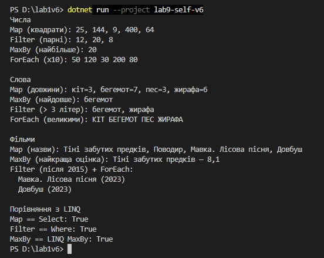

Самостійна робота №9
====================

## Тема
Делегати й лямбда-вирази: власні утиліти для колекцій.

## Мета
Поглибити розуміння делегатів та лямбда-виразів через створення власних узагальнених методів-утиліт для роботи з колекціями та повторного використання логіки.

## Хід роботи

1. **Створено консольний проєкт:** `dotnet new console -o lab9-self-v6`
2. **Реалізовано статичний клас `CollectionUtils`:**
   * **`Map<TSource, TResult>`** — перетворює кожен елемент через `Func<TSource, TResult>`.
   * **`MaxBy<T, TKey>`** — знаходить елемент з найбільшим ключем (`where TKey : IComparable<TKey>`), для порожньої колекції кидає `InvalidOperationException`.
   * **`Filter<T>`** — повертає елементи, для яких `Predicate<T>` дає `true`.
   * **`ForEach<T>`** — виконує `Action<T>` для кожного елемента.
3. **Демонстрація в `Main`:**
   * Усі 4 методи викликано для трьох колекцій — `List<int>`, `List<string>`, `List<Movie>` — з різними лямбда-виразами.
   * Результати порівняно з LINQ (`Select`, `Where`, `MaxBy`).

## Звіт

**Чому делегати корисні для таких утиліт?**
Делегат дозволяє передати в метод не дані, а **дію**. Метод `Filter` сам перебирає колекцію, а що саме перевіряти, вирішує той, хто його викликає. Тому один метод підходить для будь-яких умов і типів, і не треба писати окремі `FilterEven`, `FilterLongWords` тощо.

**Як лямбда-вирази спрощують виклик?**
Замість окремого іменованого методу логіку можна написати прямо в місці виклику: `x => x % 2 == 0`. Код коротший, і одразу видно, що він робить.

**Порівняння з LINQ:**

| Мій метод | LINQ | Різниця |
| --- | --- | --- |
| `Map` | `Select` | мій одразу створює `List`, LINQ — відкладене виконання |
| `Filter` | `Where` | так само; у мене `Predicate<T>`, у LINQ `Func<T, bool>` |
| `MaxBy` | `MaxBy` (.NET 6+) | результат однаковий |
| `ForEach` | немає (є лише `List<T>.ForEach`) | працює з будь-яким `IEnumerable<T>` |

Результати збігаються (перевірено через `SequenceEqual`). LINQ зручніший: методи викликаються через крапку й поєднуються в ланцюжки, а обчислення відкладені. Мої методи простіші, зате на них добре видно, як LINQ працює всередині.

---
## Фотозвіт

## Контрольні запитання

1. **Чому делегати є зручним механізмом для передавання поведінки в узагальнені методи?**
   * Метод описує загальний алгоритм (перебір), а конкретну дію отримує ззовні через делегат. Так одна реалізація працює з різними типами й умовами.
2. **У чому різниця між `Func<T, TResult>`, `Action<T>` та `Predicate<T>`?**
   * `Func` повертає результат, `Action` нічого не повертає (лише виконує дію), а `Predicate` приймає один параметр і повертає `bool` (умова).
3. **Які переваги дає поєднання generic-методів і лямбда-виразів під час роботи з колекціями?**
   * Generic дає роботу з будь-яким типом без приведення, а лямбда — коротку логіку прямо в місці виклику. Разом це універсальний і читабельний код без дублювання.
4. **У яких випадках власні утиліти на кшталт `Map` чи `Filter` корисно реалізовувати самостійно, навіть якщо існує LINQ?**
   * Для навчання (щоб зрозуміти, як працює LINQ), коли потрібна особлива поведінка (наприклад, своя перевірка чи логування), або коли LINQ недоступний чи потрібне саме негайне, а не відкладене виконання.

