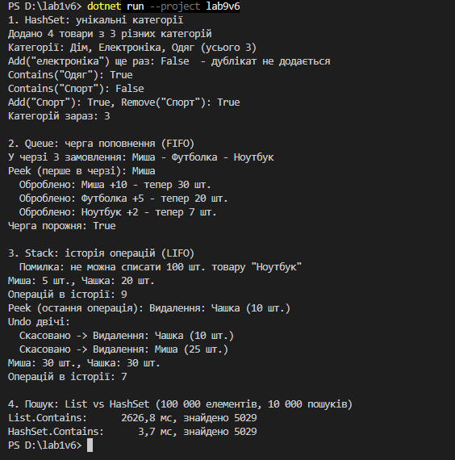

Лабораторна робота №9
=====================

## Тема
`HashSet` / `Queue` / `Stack`: практичні сценарії.

## Мета
Навчитися використовувати спеціалізовані колекції `HashSet<T>`, `Queue<T>`, `Stack<T>` для розв'язання практичних задач, зрозуміти їхні особливості та сценарії застосування.

## Хід роботи

1. **Створено консольний проєкт:** `dotnet new console -o lab9v6`
2. **Створено класи для варіанту «Управління інвентарем»:**
   * **`Product`** — товар з назвою, категорією і кількістю.
   * **`RestockOrder`** та **`InventoryOperation`** — замовлення на поповнення й операція з товаром (`record`).
   * **`Inventory`** — склад, у якому зібрано всі три колекції.
3. **Розподіл підзадач між колекціями:**
   * **`HashSet<string>` — унікальні категорії.** Категорія додається автоматично разом з товаром, дублікати (навіть з іншим регістром) не потрапляють. Показано `Add`, `Contains`, `Remove`, `Count`.
   * **`Queue<RestockOrder>` — черга замовлень на поповнення.** Замовлення обробляються в порядку надходження (FIFO). Показано `Enqueue`, `Peek`, `Dequeue`.
   * **`Stack<InventoryOperation>` — історія операцій.** Кожне додавання чи списання записується в стек, а `Undo()` скасовує останню операцію (LIFO). Показано `Push`, `Peek`, `Pop`.
4. **Порівняння продуктивності:** пошук 10 000 кодів у `List` і `HashSet` зі 100 000 елементів.

---
## Фотозвіт

## Контрольні запитання

1. **У чому різниця між `List<T>` та `HashSet<T>`?**
   * `List` зберігає елементи по порядку, дозволяє дублікати й доступ за індексом, але `Contains` у ньому повільний — O(n). `HashSet` зберігає лише унікальні елементи без порядку, зате перевірка наявності дуже швидка — O(1).
2. **Коли доцільно використовувати `Queue<T>` замість `List<T>`?**
   * Коли елементи треба обробляти строго в порядку надходження: черга завдань, замовлень, повідомлень. `Dequeue()` одразу забирає найперший елемент, і не треба вручну видаляти його з початку списку.
3. **Наведіть приклад реальної задачі, де потрібен `Stack<T>`.**
   * Кнопка «Скасувати» (Undo) в редакторі чи, як у моїй лабі, скасування останньої операції на складі; кнопка «Назад» у браузері; перевірка правильності дужок у виразі.
4. **Яка складність операції `Contains()` для `HashSet<T>` і чому?**
   * O(1) у середньому. `HashSet` за хеш-кодом елемента одразу визначає, де він має лежати, і не перебирає всі елементи, як `List`.
5. **Чому `Queue<T>` називають FIFO, а `Stack<T>` — LIFO?**
   * FIFO (First In, First Out) — хто перший прийшов, той перший і вийде, як черга в магазині. LIFO (Last In, First Out) — останнім поклали, першим забрали, як стопка тарілок.

---
